# Awesome GPT Image 2.6（Images 2.6）

> 非官方精选合集：介绍 OpenAI **Images 2.6** / **GPT Image 2.6**（Flare & Sunburst）的模型特性、接入方式与可复现案例画廊。  
> 图例与提示词均整理自 OpenAI 官方公告与开发者文档；仓库内图片为文档示例的镜像缓存，版权归原作者/OpenAI 所有，仅作学习索引。


| 项目 | 内容 |
|------|------|
| 产品名（ChatGPT / Codex） | **Images 2.6** |
| API 型号 | `gpt-image-2.6-flare`、`gpt-image-2.6-sunburst` |
| 厂商 | OpenAI |
| 公开发布 | **2026-11-04**（UTC 口径的官方发布日） |
| 可用入口 | ChatGPT、Codex、Images API（`/v1/images/generations`、`/v1/images/edits`） |

本页 GitHub Pages：<https://xianyu110.github.io/awesome-gpt-images-2.6/>

本仓库已整合 [Awesome AI Creative Gallery](https://github.com/li-xiu-qi/awesome-ai-creative-gallery) 的图库页面与素材：<https://xianyu110.github.io/awesome-gpt-images-2.6/gallery/>。图库包含 92 个可筛选案例，页面脚本、样式和媒体位于 `docs/gallery/assets/`；本仓库原有的 Images 2.6 详细案例页保留在 [`docs/images-2-6.html`](docs/images-2-6.html)。

---

## 简介

OpenAI 于 2026 年 11 月 4 日推出 **Images 2.6**。官方称相对上一代，图像生成速度约 **提升 50%**；在 ChatGPT / Codex 全订阅档位可用，API 侧提供两档模型：

- **GPT Image 2.6 Flare**（`gpt-image-2.6-flare`）：偏重**快速迭代**。`quality=low` 时官方称最快约 **6 秒**；海报、产品图等版式质量有改善。
- **GPT Image 2.6 Sunburst**（`gpt-image-2.6-sunburst`）：偏重**细节与编辑一致性**；`quality` 为 medium/high 时更适合精细构图与多轮精修。

两款模型均支持文生图与图生图/编辑，官方强调角色、产品与品牌细节在编辑轮次中更易保持一致，并新增 **原生 GIF 动画**、**SVG 导出**、API 侧 **markup（标注）引导编辑**，以及独立的 **`complexity`（规划复杂度）** 参数。

> 命名说明：对外产品页多用 **Images 2.6**；API 文档与模型卡使用 **GPT Image 2.6 Flare / Sunburst**。社区口语中的「GPT Images 2.6」一般即指上述产品线。

主要来源：[Introducing Images 2.6](https://openai.com/index/introducing-images-2-6/) · [Image generation](https://developers.openai.com/api/docs/guides/image-generation) · [Image prompting](https://developers.openai.com/api/docs/guides/image-prompting)

---

## 模型特性

### 能力边界（据官方文档）

| 能力 | 说明 |
|------|------|
| 生成 | `POST /v1/images/generations`，文本提示 → 图像 |
| 编辑 | `POST /v1/images/edits`，参考图 / mask / markup + 提示 → 图像 |
| 输入模态 | 文本、图像 |
| 输出格式 | `png` / `jpeg` / `webp`；**生成**另支持 `svg`、`gif`（编辑端不支持 GIF/SVG 输出） |
| 透明背景 | `background=transparent`，配合 PNG/WebP/SVG |
| GIF | `frame_count`（约 2–64，以当前文档为准）、`frame_duration_ms`（约 20–2000，10ms 对齐） |
| SVG | 静态矢量路径；不可流式、不可 partial；`n=1` |
| Markup 编辑 | 与首张输入图同尺寸的透明 PNG 标注层，圈出要改区域 |
| 流式 | 支持 partial images（GIF/SVG 除外） |

### 关键参数（GPT Image 2.6）

| 参数 | 取值 | 作用 |
|------|------|------|
| `model` | `gpt-image-2.6-flare` / `gpt-image-2.6-sunburst` | 选型 |
| `quality` | `auto` / `low` / `medium` / `high` / `xhigh` / `max` | 渲染细节与保真度 |
| `complexity` | `low` / `medium` / `high`（省略时默认 `high`） | 生成前规划程度；与 quality 独立，无单独计费项 |
| `size` | `auto` 或如 `1024x1024`、`1536x1024`、`1024x1536`；自定义宽高需为 16 倍数，纵横比约 1:3–3:1 | 输出尺寸 |
| `background` | `auto` / `opaque` / `transparent` | 背景 |
| `output_format` | `png` / `jpeg` / `webp` / `svg` / `gif` | 输出格式 |
| `markup` | 透明 PNG 叠加层（仅 edits） | 局部编辑定位 |

### 与上一代的差异（官方表述摘要）

- 速度：Images 2.6 宣称较之前约快 **50%**；Flare 在 low quality 可达约 6 秒。
- 新增：原生 **GIF**、**SVG**、API **markup**、独立 **`complexity`**。
- 定位延续 2.5 的 Flare（快）/ Sunburst（精）双轨；官方建议从对应的 2.5 工作流迁移到 2.6 同名档位，再对比延迟与质量。
- 编辑侧：官方称角色/产品/品牌一致性更好；2.6 **不支持** `input_fidelity`、`reasoning.summary`（文档明确）。

### 定价快照（模型卡，可能变动）

Flare 与 Sunburst 公开模型卡上的 token 价目一致（以官网为准）：

| 类型 | 价格 |
|------|------|
| 文本输入 | $5 / 1M tokens（缓存输入 $1.25） |
| 图像输入 | $8 / 1M tokens（缓存输入 $2） |
| 图像输出 | $30 / 1M tokens |

详见：[Flare 模型卡](https://developers.openai.com/api/docs/models/gpt-image-2.6-flare) · [Sunburst 模型卡](https://developers.openai.com/api/docs/models/gpt-image-2.6-sunburst) · [Pricing](https://openai.com/api/pricing/)

### 已知限制（官方）

- 复杂提示可能延迟较长（文档提到可达约 2 分钟量级）。
- 文字渲染已改善，但精确排版仍可能出错。
- 跨多次生成的角色/品牌一致性仍可能漂移，需复述约束或固定参考图。
- 结构化构图的精确定位仍有挑战。
- 内容审核：`moderation=auto|low`；违规返回 `moderation_blocked` 等。

---

## 快速开始 / 接入

### 官方（推荐）

1. 在 [OpenAI Platform](https://platform.openai.com/) 创建项目并完成组织验证（部分图像能力需要）。
2. 设置环境变量 `OPENAI_API_KEY`。
3. 调用 Images API，例如：

```bash
curl -X POST "https://api.openai.com/v1/images/generations" \
  -H "Authorization: Bearer $OPENAI_API_KEY" \
  -H "Content-Type: application/json" \
  -d '{
    "model": "gpt-image-2.6-sunburst",
    "prompt": "A minimalist product poster of a ceramic mug on limestone, soft window light, no text",
    "quality": "medium",
    "complexity": "low",
    "size": "1024x1024",
    "output_format": "png"
  }'
```

Python 示例（摘自官方引导的模型 ID 习惯）：

```python
from openai import OpenAI
import base64

client = OpenAI()
result = client.images.generate(
    model="gpt-image-2.6-flare",
    prompt="A children's book drawing of a veterinarian listening to a baby otter with a stethoscope.",
    quality="medium",
    size="1024x1024",
)
Path = __import__("pathlib").Path
Path("otter.png").write_bytes(base64.b64decode(result.data[0].b64_json))
```

更多： [Image generation guide](https://developers.openai.com/api/docs/guides/image-generation) · [Image prompting guide](https://developers.openai.com/api/docs/guides/image-prompting)

ChatGPT 用户可直接在对话中使用 Images 2.6（含 GIF）；无需写代码。

### 国内/兼容访问笔记（可选）

官方 Platform / ChatGPT 仍是首选。若因网络或支付需要临时走兼容入口，下列为社区常用渠道备忘（**非广告**；可用性、合规与计费以各站点当时条款为准，本仓库不做保证）。调用 API 时模型名仍建议写 `gpt-image-2.6-flare` / `gpt-image-2.6-sunburst`（以网关实际挂载为准）。

| 渠道类型 | 访问网址 | 适用场景 |
|----------|----------|----------|
| GPT 国内高速镜像站 | https://trygpt.asia/list/#/home | 适合网页端免梯直接对话、工作流轻量体验 |
| MomoAI 包月套餐 | https://momoai.asia/home | 适合持续使用、希望按月订阅套餐的用户 |
| 全模型 API 聚合站 | https://tryallapi.com/ | 适合开发者调用、低延迟直连、多模型一站式接入 |
| Images 2.6 模型页（站内） | https://gptimage2.asia/models/gpt-images-2.6 | 产品介绍与试用入口（可选） |
| 官方代充通道 | https://chongzhi.trygpt.asia/ | 解决海外支付门槛，官方账户直充 |
| Trymodel 多模型聊天 | https://trymodel.chat/ | 适合在同一网页中体验不同 AI 模型的对话 |

补充：在 tryallapi 注册/邀请场景可自行附加 `aff=5A6A`（例如 `https://tryallapi.com/?aff=5A6A`），非必需。相关工具店铺（可选）：[https://wzyp.cn/shop/maynorai](https://wzyp.cn/shop/maynorai)

---

## 案例画廊

下列案例提示词与示意输出整理自 OpenAI 官方文档/公告、官方 X，以及**可核实的社区 X 原帖**（作者自称 Images 2.6 / GPT Image 2.6 / Flare / Sunburst，且附带生成结果）。图片保存在本仓库 `images/`。**不编造提示词**；仅收录原帖可见原文，不完整则标明「提示词见原帖」或「提示词未公开」。跳过纯新闻转发、隐私风险真人照动图、明显 IP 侵权角色。

### 1. Complexity 对比：纸雕足球夺冠（Sunburst）

**场景**：同一提示、同一 `quality=medium`，对比 `complexity=low|medium|high` 对构图与「CHAMPIONS」位置的影响。

**提示词**：

```text
A premium handcrafted layered paper-cut illustration of a football team celebrating a championship victory inside a packed stadium.
```

**参数提示**：`model=gpt-image-2.6-sunburst`，`size=1024x1536`，`quality=medium`

| Low | Medium | High |
|-----|--------|------|
|  |  |  |

来源：[Image prompting · Compare complexity](https://developers.openai.com/api/docs/guides/image-prompting)

---

### 2. 原生循环 GIF：提灯小猴（Sunburst）

**提示词**：

```text
A little monkey in an olive-green hooded coat stands in a snowy pine forest at dusk. A wooden cabin glows in the background. The monkey holds a glowing amber paper lantern at chest height, slowly lifts it, looks up and blinks, then lowers it back to its starting pose. Keep the lantern in its hands and the camera still. Make the motion loop smoothly.
```

**参数提示**：`output_format=gif`，`size=512x512`，`quality=high`，`frame_count=9`，`frame_duration_ms=200`（约 1.8s 循环）


来源：[Image prompting · Generate a looping GIF](https://developers.openai.com/api/docs/guides/image-prompting)

---

### 3. 纪实摄影风：渔民与狗（Flare vs Sunburst）

**提示词**：

```text
Create a photorealistic candid photograph of an elderly sailor standing on a small fishing boat.
He has weathered skin with visible wrinkles, pores, and sun texture, and a few faded traditional sailor tattoos on his arms.
He is calmly adjusting a net while his dog sits nearby on the deck. Shot like a 35mm film photograph, medium close-up at eye level, using a 50mm lens.
Soft coastal daylight, shallow depth of field, subtle film grain, natural color balance.
The image should feel honest and unposed, with real skin texture, worn materials, and everyday detail. No glamorization, no heavy retouching.
```

| Flare | Sunburst |
|-------|----------|
|  |  |

来源：[Image prompting · Control style and lighting](https://developers.openai.com/api/docs/guides/image-prompting)

---

### 4. 信息图：全自动咖啡机流程（Sunburst）

**提示词**：

```text
Create a detailed Infographic of the functioning and flow of an automatic coffee machine like a Jura.
From bean basket, to grinding, to scale, water tank, boiler, etc.
I'd like to understand technically and visually the flow.
```


来源：[Image prompting · Explain a process visually](https://developers.openai.com/api/docs/guides/image-prompting)

---

### 5. 精确文案广告：Thread「Yours to Create.」（Sunburst）

**提示词**：

```text
Give me a cool in culture ad / fashion shot for a brand called Thread.
It's a hip young street brand. The ad shows a group of friends hanging out together with the tagline "Yours to Create."
Make it feel like a polished campaign image for a youth streetwear audience: stylish, contemporary, energetic, and tasteful.
Use clean composition, strong color direction, natural poses, and premium fashion photography cues.
Render the tagline exactly once, clearly and legibly, integrated into the ad layout.
No extra text, no watermarks, no unrelated logos.
```


来源：[Image prompting · Render exact text](https://developers.openai.com/api/docs/guides/image-prompting)

---

### 6. SVG Logo：Field & Flour 面包店

**提示词**：

```text
Create an original, non-infringing logo for a company called Field & Flour, a local bakery.
The logo should feel warm, simple, and timeless. Use clean, vector-like shapes, a strong silhouette, and balanced negative space.
Favor simplicity over detail so it reads clearly at small and large sizes. Flat design, minimal strokes, no gradients unless essential.
Fully transparent background. Deliver a single centered logo with generous padding, clean alpha edges, and no solid backdrop, scenery, checkerboard, or watermark.
```

**参数提示**：`output_format=svg`，`n=1`

| Flare SVG | Sunburst SVG | Sunburst 栅格示例 |
|-----------|--------------|-------------------|
|  |  |  |

来源：[Image prompting · Generate SVG / Design a reusable logo](https://developers.openai.com/api/docs/guides/image-prompting)

---

### 7. 四格漫画：宠物在家狂欢（Sunburst）

**提示词**：

```text
Create a short vertical comic-style reel with 4 panels.
Panel 1: The owner leaves through the front door. The pet is framed in the window behind them, small against the glass, eyes wide, paws pressed high, the house suddenly quiet.
Panel 2: The door clicks shut. Silence breaks. The pet slowly turns toward the empty house, posture shifting, eyes sharp with possibility.
Panel 3: The house transformed. The pet sprawls across the couch like it owns the place, crumbs nearby, sunlight cutting across the room like a spotlight.
Panel 4: The door opens. The pet is seated perfectly by the entrance, alert and composed, as if nothing happened.
```


来源：[Image prompting · Turn a story into a comic strip](https://developers.openai.com/api/docs/guides/image-prompting)

---

### 8. UI 预览：农贸市场 App（Sunburst）

**提示词**：

```text
Create a realistic mobile app UI mockup for a local farmers market.
Show today's market with a simple header, a short list of vendors with small photos and categories, a small "Today's specials" section, and basic information for location and hours.
Design it to be practical, and easy to use. White background, subtle natural accent colors, clear typography, and minimal decoration.
It should look like a real, well-designed, beautiful app for a small local market.
Place the UI mockup in an iPhone frame.
```


来源：[Image prompting · Create an interface preview](https://developers.openai.com/api/docs/guides/image-prompting)

---

### 9. 科学教育图：细胞呼吸一览（Sunburst）

**提示词**：

```text
Create a simple biology diagram titled "Cellular Respiration at a Glance" for high school students.

Show how glucose turns into energy inside a cell. Include glycolysis, the Krebs cycle, and the electron transport chain.
Use arrows to connect the steps, and label the main molecules: glucose, pyruvate, ATP, NADH, FADH2, CO2, O2, and H2O.
Make it look like a clean classroom handout or slide, with a white background, simple icons, clear labels, and easy-to-read text.

Avoid tiny text, extra decoration, or anything that makes the diagram hard to understand.
```


来源：[Image prompting · Create scientific and educational visuals](https://developers.openai.com/api/docs/guides/image-prompting)

---

### 10. 路演幻灯片：Market Opportunity（Sunburst）

**提示词**（文中 TAM/SAM/SOM 等数字为官方示例中的**虚构**数据，使用前请替换为真实数据）：

```text
Create one pitch-deck slide titled **"Market Opportunity"** that feels like a real Series A fundraising slide from a YC-backed startup.

Use a clean white background, modern sans-serif typography like Inter, and a crisp, minimal layout. The slide should include:

* A TAM/SAM/SOM concentric-circle diagram in muted blues and grays
* Specific, believable market sizing numbers:

  * **TAM:** $42B
  * **SAM:** $8.7B
  * **SOM:** $340M
* A clean bar chart below showing market growth from **2021 to 2026**, with a subtle upward trend
* Small footnotes: **"AGI Research, 2024"** and **"Internal analysis"**
* A company logo placeholder in the bottom-right corner

The design should look like it belongs in a deck that actually raised money: highly readable text, clear data hierarchy, polished spacing, and professional startup-style visual language.

Avoid clip art, stock photography, gradients, shadows, decorative elements, or anything that feels generic or overdesigned.
```


来源：[Image prompting · Build slides, diagrams, and charts](https://developers.openai.com/api/docs/guides/image-prompting)

---

### 11. Markup 局部编辑：厨房花瓶改色（Flare）

左：标注预览输入；右：Flare 编辑结果。

**提示词**：

```text
Recolor the striped vase inside the red circle to solid cobalt blue ceramic. Keep its shape, the dried stems, and the rest of the kitchen unchanged. Remove the red circle from the finished photo.
```

| 输入（含标注） | Flare 输出 |
|----------------|------------|
| 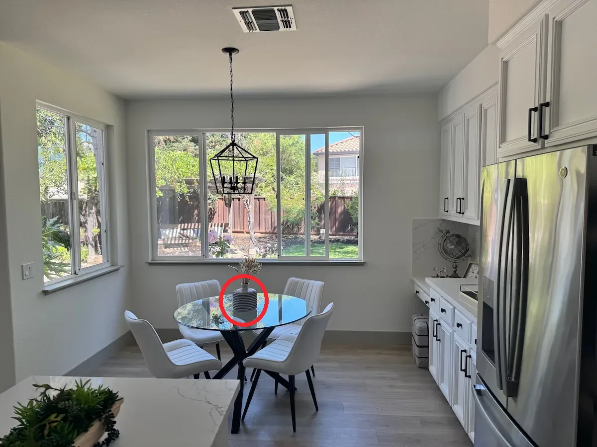 |  |

来源：[Image prompting · Guide an edit with markup](https://developers.openai.com/api/docs/guides/image-prompting) · [Image generation · markup](https://developers.openai.com/api/docs/guides/image-generation)

---

### 12. 透明抠图产品（Sunburst）

**提示词**：

```text
Extract the product from the input image and isolate it on a fully transparent background.
Output: centered product, crisp silhouette, no halos/fringing.
Preserve product geometry and label legibility exactly.
Add only light polishing. Do not add a solid backdrop, checkerboard, scenery, or shadow.
Do not restyle the product; remove the background and preserve clean alpha transparency.
```


来源：[Image prompting · Create a transparent product cutout](https://developers.openai.com/api/docs/guides/image-prompting)

---

### 13. 节日贺卡：旧泰迪熊（Sunburst）

**提示词**：

```text
Create a Christmas holiday card illustration.

Scene:
a cozy Christmas scene with an old teddy bear sitting inside a keepsake box, slightly worn fur, soft stitching repairs, placed near a window with falling snow outside. The scene suggests the child has grown up, but the memories remain.

Mood:
Warm, nostalgic, gentle, emotional.

Style:
Premium holiday card photography, soft cinematic lighting,
realistic textures, shallow depth of field,
tasteful bokeh lights, high print-quality composition.

Constraints:
- Original artwork only
- No trademarks
- No watermarks
- No logos

Include ONLY this card text (verbatim):
"Merry Christmas — some memories never fade."
```


来源：[Image prompting · Design a holiday card](https://developers.openai.com/api/docs/guides/image-prompting)

---

### 14. 收藏玩具包装：复古螺旋桨飞机（Sunburst）

**提示词**：

```text
Create a collectible action figure of a vintage-style toy propeller airplane with rounded wings, a front-mounted spinning propeller, slightly worn paint edges, classic childhood proportions, designed as a nostalgic holiday collectible, in blister packaging.

Concept:
A nostalgic holiday collectible inspired by the simple toy airplanes
children used to play with during winter holidays.
Evokes warmth, imagination, and childhood wonder.

Style:
Premium toy photography, realistic plastic and painted metal textures,
studio lighting, shallow depth of field,
sharp label printing, high-end retail presentation.

Constraints:
- Original design only
- No trademarks
- No watermarks
- No logos

Include ONLY this packaging text (verbatim):
"Christmas Memories Edition"
```


来源：[Image prompting · Design collectible merchandise](https://developers.openai.com/api/docs/guides/image-prompting)

---

### 15. 公告案例：OpenArt 股价表情 GIF 精灵表

OpenAI 发布页展示由 **OpenArt** 制作、标注为 Images 2.6 能力的 chibi 办公室职员动画精灵表（下跌流泪 / 上涨撒钱）。下列英文提示词为公告原文。

**提示词 1（下跌）**：

```text
Create a single animation sprite sheet for a seamless looping GIF. A super-cute chibi adult office worker sits at a desk watching a computer monitor with a clearly plunging stock-market line chart. The sequence: hopeful expression, notices the chart falling, eyes widen, face crumples, large cartoon tears stream down both cheeks, then quietly wipes tears while still staring at the falling chart. Oversized round head, tiny body, big expressive eyes, soft rounded features, messy fluffy hair, white shirt and loosened tie. Exactly 6 sequential frames arranged in a precise 3-column by 2-row grid, read left-to-right then top-to-bottom. Every panel has identical dimensions. Fixed front three-quarter camera, same character, same desk, monitor, outfit, and cozy miniature office background. Clear incremental facial and tear motion; sixth frame transitions smoothly toward the first. Polished kawaii chibi 3D toy-like style, warm pastel lighting, funny and sympathetic mood. No captions, no words, no numbers, no logos, no speech bubbles, no panel labels, no borders, no gutters.
```

**提示词 2（上涨）**：

```text
Create a single animation sprite sheet for a seamless looping GIF. A super-cute chibi adult office worker sits at a desk watching a computer monitor with a clearly soaring stock-market line chart and a large upward arrow. The sequence: notices the chart rising, eyes widen with delight, jumps up cheering, grabs a handful of generic paper banknotes with no readable currency markings, then happily tosses the banknotes into the air like confetti while laughing. Oversized round head, tiny body, big sparkling expressive eyes, soft rounded features, messy fluffy hair, white shirt and loosened tie. Exactly 6 sequential frames arranged in a precise 3-column by 2-row grid, read left-to-right then top-to-bottom. Every panel has identical dimensions. Fixed front three-quarter camera, same character, desk, monitor, outfit, and cozy miniature office background. Clear incremental body, arm, and flying-paper motion; sixth frame transitions smoothly toward the first. Polished kawaii chibi 3D toy-like style, bright celebratory pastel lighting, funny joyful mood. No captions, no words, no numbers, no logos, no real currency symbols, no speech bubbles, no panel labels, no borders, no gutters.
```

**本仓库图片**：公告社交头图缓存 `images/images-2-6-social.png`；精灵表成图以公告页为准（页面资源多为动态/CDN，未二次镜像逐帧大图，避免失效）。

来源：[Introducing Images 2.6 · Animate your ideas with GIFs](https://openai.com/index/introducing-images-2-6/)（Created by OpenArt）

---

### 16. 历史语境：1969 年 Bethel 户外人群（生成）

**参数**：`size=1024x1536`，`quality=medium`。官方标注 GPT Image 2.6 Flare / Sunburst。

**提示词**：

```text
Create a realistic outdoor crowd scene in Bethel, New York on August 16, 1969.
Photorealistic, period-accurate clothing, staging, and environment.
```

| Flare | Sunburst |
|:-----:|:--------:|
|  |  |

来源：[Image prompting · Use historical and real-world context](https://developers.openai.com/api/docs/guides/image-prompting)

---

### 17. 布局保持翻译：咖啡机信息图 → 西班牙语（编辑）

以案例 4 的咖啡机信息图为输入；官方 2.6 Flare / Sunburst 输出。

**参数**：`size=1024x1536`，`quality=high`。

**提示词**：

```text
Translate the text in the infographic to Spanish. Do not change any other aspect of the image.
```

| Flare | Sunburst |
|:-----:|:--------:|
| 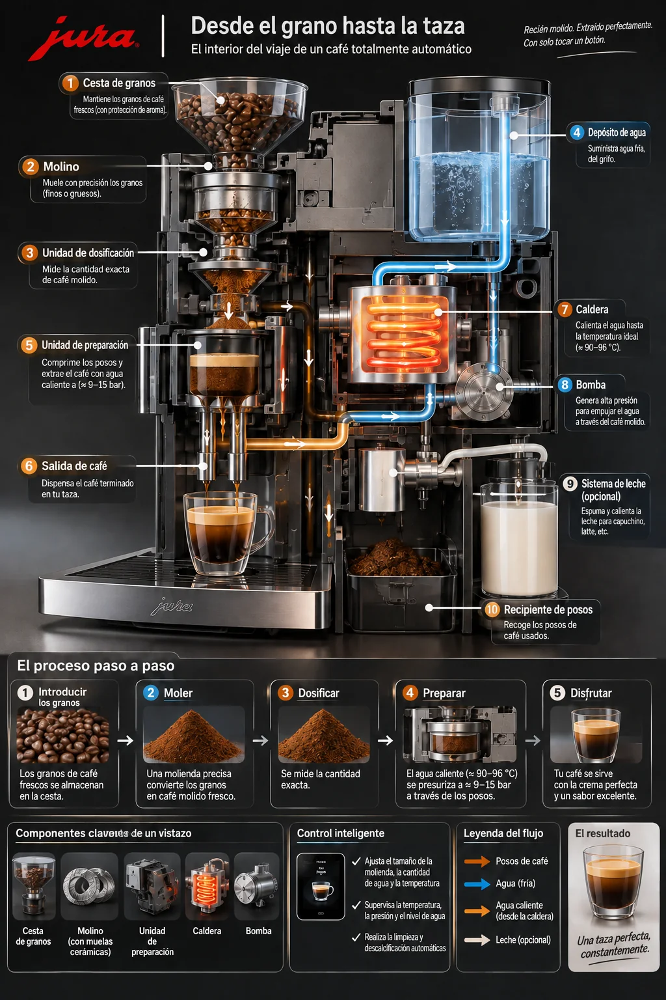 |  |

来源：[Image prompting · Translate while preserving layout](https://developers.openai.com/api/docs/guides/image-prompting)

---

### 18. 风格迁移：像素风摩托骑士（编辑）

输入为文档中的像素风参考图；官方标注 2.6 Flare / Sunburst。

**参数**：`size=1024x1536`，`quality=medium`。

**提示词**：

```text
Use the same style from the input image and generate a man riding a motorcycle on a white background.
```

| Flare | Sunburst |
|:-----:|:--------:|
| 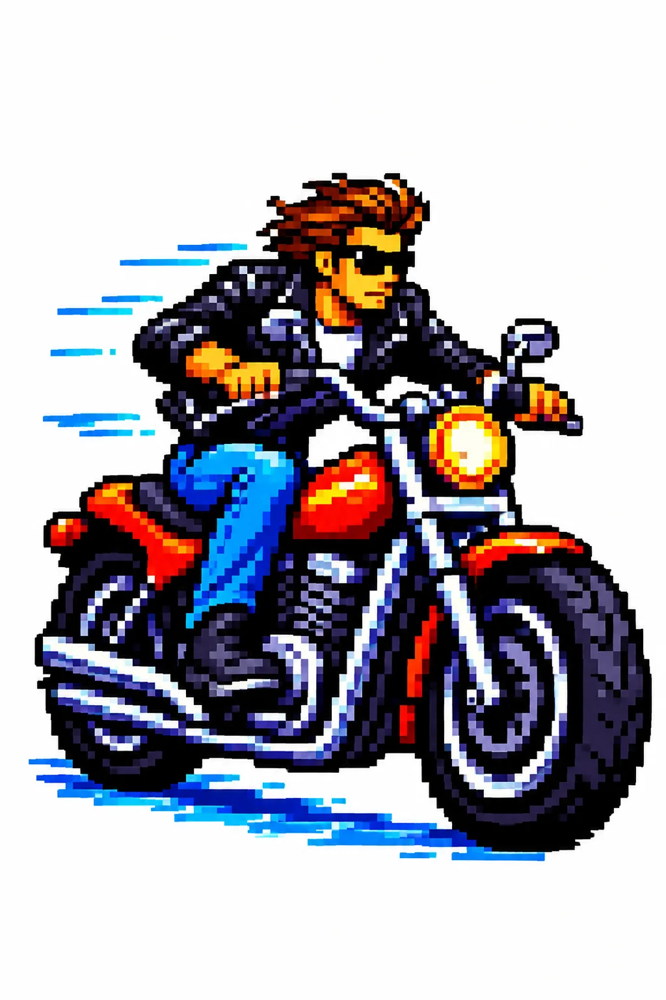 |  |

来源：[Image prompting · Transfer a visual style](https://developers.openai.com/api/docs/guides/image-prompting)

---

### 19. 身份保持换装（编辑）

人物照片 + 三件服装参考；官方 2.6 Flare / Sunburst。

**参数**：`size=1024x1536`，`quality=medium`。

**提示词**：

```text
Edit the image to dress the woman using the provided clothing images. Do not change her face, facial features, skin tone, body shape, pose, or identity in any way. Preserve her exact likeness, expression, hairstyle, and proportions. Replace only the clothing, fitting the garments naturally to her existing pose and body geometry with realistic fabric behavior. Match lighting, shadows, and color temperature to the original photo so the outfit integrates photorealistically, without looking pasted on. Do not change the background, camera angle, framing, or image quality, and do not add accessories, text, logos, or watermarks.
```

| Flare | Sunburst |
|:-----:|:--------:|
| 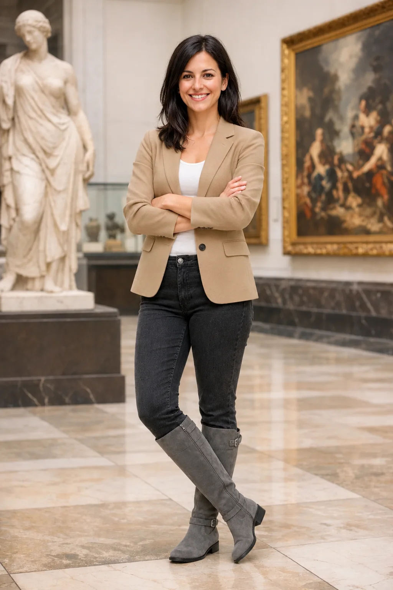 |  |

来源：[Image prompting · Preserve identity and change clothing](https://developers.openai.com/api/docs/guides/image-prompting)

---

### 20. 多图合成：把狗放入场景（编辑）

场景图为 image 1、狗为 image 2；官方 2.6 Flare / Sunburst。

**参数**：`size=1024x1536`，`quality=medium`。

**提示词**：

```text
Place the dog from the second image into the setting of image 1, right next to the woman, use the same style of lighting, composition and background. Do not change anything else.
```

| Flare | Sunburst |
|:-----:|:--------:|
| 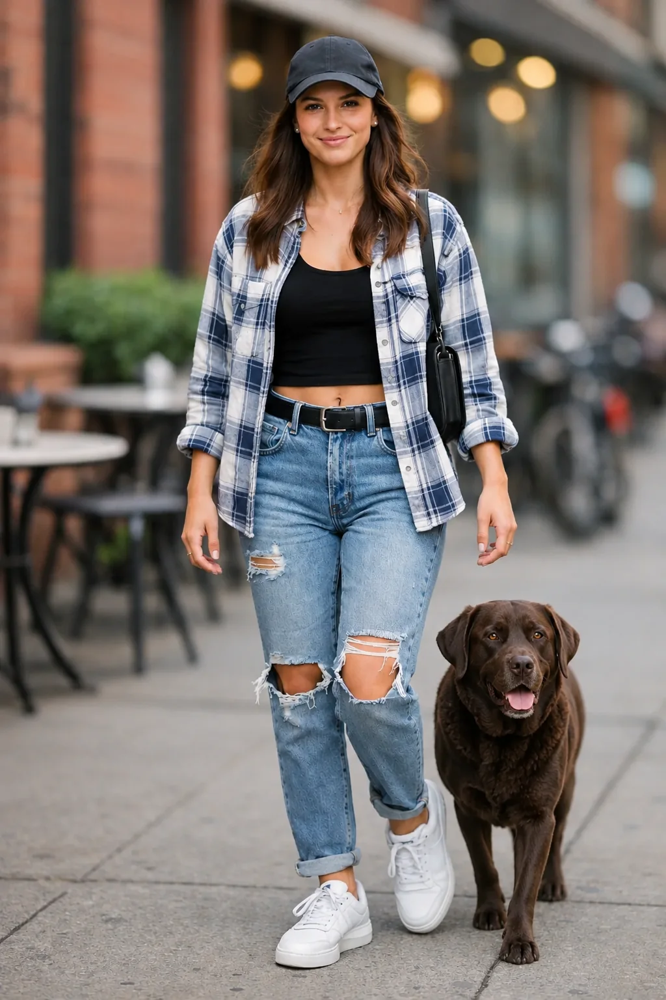 |  |

来源：[Image prompting · Combine references](https://developers.openai.com/api/docs/guides/image-prompting)

---

### 21. 草图转写实山谷（编辑）

**参数**：`size=1024x1536`，`quality=medium`。

**提示词**：

```text
Turn this drawing into a photorealistic image.
Preserve the exact layout, proportions, and perspective.
Choose realistic materials and lighting consistent with the sketch intent.
Do not add new elements or text.
```

| Flare | Sunburst |
|:-----:|:--------:|
|  |  |

来源：[Image prompting · Turn a drawing into a realistic image](https://developers.openai.com/api/docs/guides/image-prompting)

---

### 22. 局部移除：拿掉手中的花（编辑）

**参数**：`size=1024x1536`，`quality=medium`。

**提示词**：

```text
Remove the flower from man's hand. Do not change anything else.
```

| Flare | Sunburst |
|:-----:|:--------:|
|  | 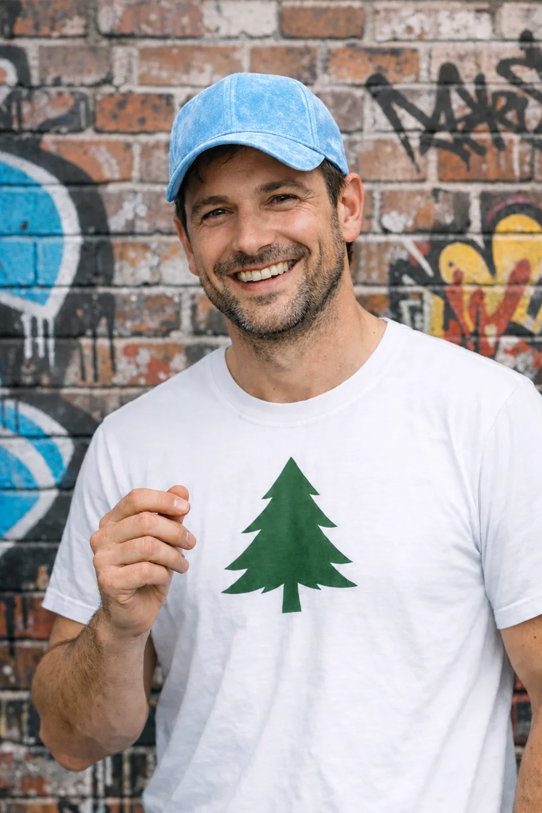 |

来源：[Image prompting · Remove an object](https://developers.openai.com/api/docs/guides/image-prompting)

---

### 23. 人物入景：营地与熊（编辑）

以博物馆女性照片为输入；官方强调省略 `input_fidelity`。

**参数**：`size=1024x1536`，`quality=medium`。

**提示词**：

```text
Generate a highly realistic action scene where this person is running away from a large, realistic brown bear attacking a campsite. The image should look like a real photograph someone could have taken, not an overly enhanced or cinematic movie-poster image.
She is centered in the image but looking away from the camera, wearing outdoorsy camping attire, with dirt on her face and tears in her clothing. She is clearly afraid but focused on escaping, running away from the bear as it destroys the campsite behind her.
The campsite is in Yosemite National Park, with believable natural details. The time of day is dusk, with natural lighting and realistic colors. Everything should feel grounded, authentic, and unstyled, as if captured in a real moment. Avoid cinematic lighting, dramatic color grading, or stylized composition.
```

| Flare | Sunburst |
|:-----:|:--------:|
|  |  |

来源：[Image prompting · Insert a person into a scene](https://developers.openai.com/api/docs/guides/image-prompting)

---

### 24. 多轮精修起点：洗发水公路广告牌（编辑）

以透明抠图洗发水产品为输入；官方 2.6 Flare / Sunburst。

**参数**：`size=1024x1536`，`quality=medium`。

**提示词**：

```text
Create a realistic billboard mockup of the shampoo on a highway scene during sunset.
Billboard text (EXACT, verbatim, no extra characters):
"Fresh and clean"
Typography: bold sans-serif, high contrast, centered, clean kerning.
Ensure text appears once and is perfectly legible.
No watermarks, no logos.
```

| Flare | Sunburst |
|:-----:|:--------:|
|  | 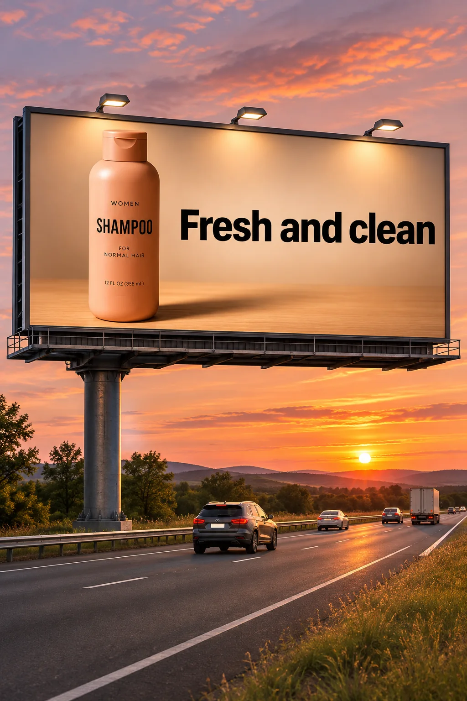 |

来源：[Image prompting · Create the starting image](https://developers.openai.com/api/docs/guides/image-prompting)

---

### 25. 多轮精修：广告牌改为冬夜雪景（编辑）

以上一步各模型广告牌输出为输入。

**参数**：`size=1024x1536`，`quality=medium`。

**提示词**：

```text
Make it look like a winter evening with snowfall.
```

| Flare | Sunburst |
|:-----:|:--------:|
| 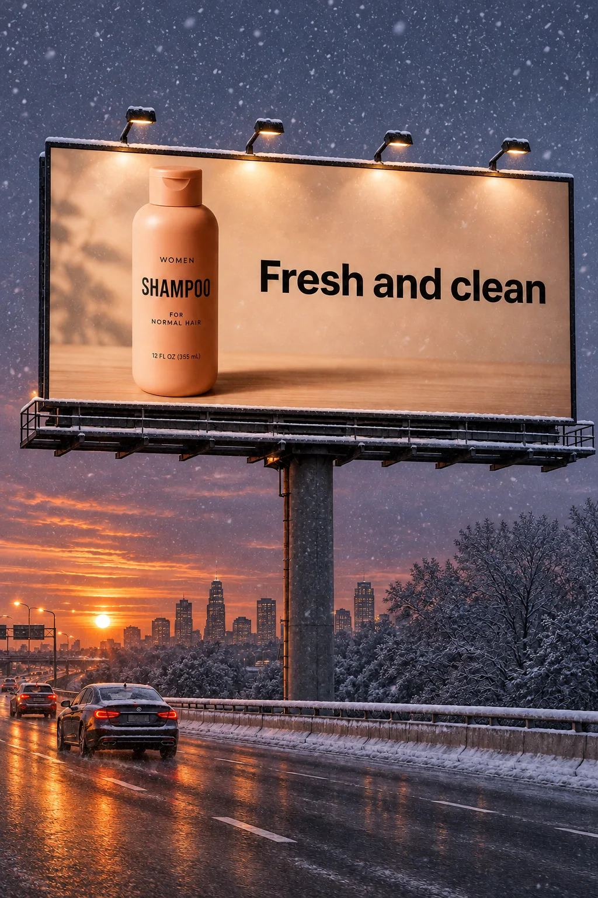 |  |

来源：[Image prompting · Change one condition](https://developers.openai.com/api/docs/guides/image-prompting)

---

### 26. 角色一致性：建立儿童书主角（生成）

**参数**：`size=1024x1536`，`quality=medium`。

**提示词**：

```text
Create a children’s book illustration introducing a main character.

Character:
A young, storybook-style hero inspired by a little forest outlaw,
wearing a simple green hooded tunic, soft brown boots, and a small belt pouch.
The character has a kind expression, gentle eyes, and a brave but warm demeanor.
Carries a small wooden bow used only for helping, never harming.

Theme:
The character protects and rescues small forest animals like squirrels, birds, and rabbits.

Style:
Children’s book illustration, hand-painted watercolor look,
soft outlines, warm earthy colors, whimsical and friendly.
Proportions suitable for picture books (slightly oversized head, expressive face).

Constraints:
- Original character (no copyrighted characters)
- No text
- No watermarks
- Plain forest background to clearly showcase the character
```

| Flare | Sunburst |
|:-----:|:--------:|
|  |  |

来源：[Image prompting · Establish the character](https://developers.openai.com/api/docs/guides/image-prompting)

---

### 27. 角色一致性：续写雪后救松鼠（编辑）

复用上一步角色图；官方 2.6 Flare / Sunburst。

**参数**：`size=1024x1536`，`quality=medium`。

**提示词**：

```text
Continue the children’s book story using the same character.

Scene:
The same young forest hero is gently helping a frightened squirrel
out of a fallen tree after a winter storm.
The character kneels beside the squirrel, offering reassurance.

Character Consistency:
- Same green hooded tunic
- Same facial features, proportions, and color palette
- Same gentle, heroic personality

Style:
Children’s book watercolor illustration,
soft lighting, snowy forest environment,
warm and comforting mood.

Constraints:
- Do not redesign the character
- No text
- No watermarks
```

| Flare | Sunburst |
|:-----:|:--------:|
|  |  |

来源：[Image prompting · Continue the story](https://developers.openai.com/api/docs/guides/image-prompting)

---

### 28. 室内家具替换：白椅 → 木椅（编辑）

**参数**：`size=1536x1024`，`quality=medium`。

**提示词**：

```text
In this room photo, replace ONLY the white chairs with chairs made of wood.
Preserve camera angle, room lighting, floor shadows, and surrounding objects.
Keep all other aspects of the image unchanged.
Photorealistic contact shadows and fabric texture.
```

| Flare | Sunburst |
|:-----:|:--------:|
| 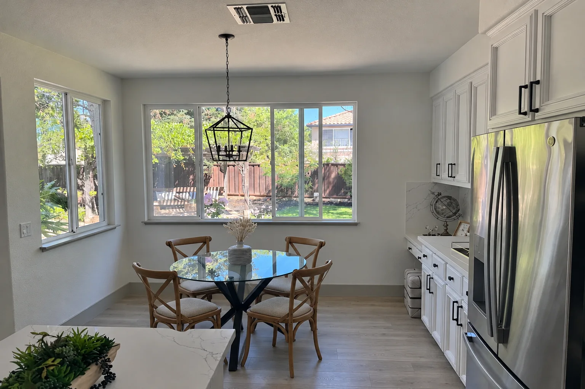 |  |

来源：[Image prompting · Change furniture in a room](https://developers.openai.com/api/docs/guides/image-prompting)

---

### 29. 官方账号宣传片（有图无提示词）

OpenAI / OpenAIDevs 发布 Images 2.6 时附带宣传视频；下列为视频预览静帧镜像，**非** API 示例输出。

**提示词未公开**（宣传成片，无逐步复现提示）。

| @OpenAI | @OpenAIDevs |
|:-------:|:-----------:|
| 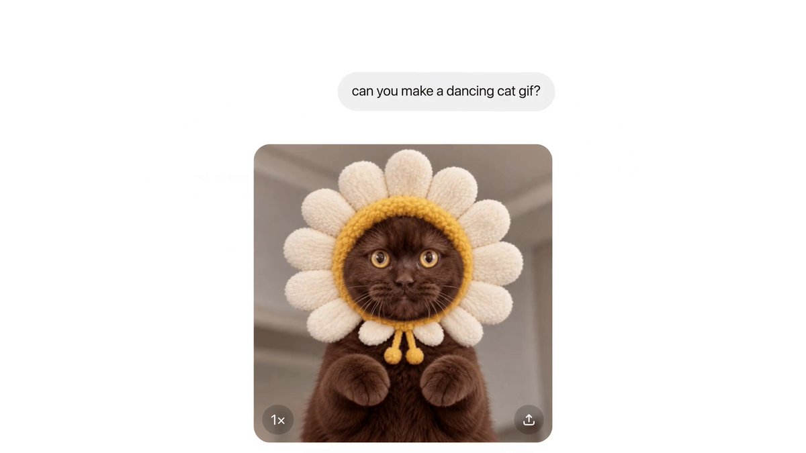 | 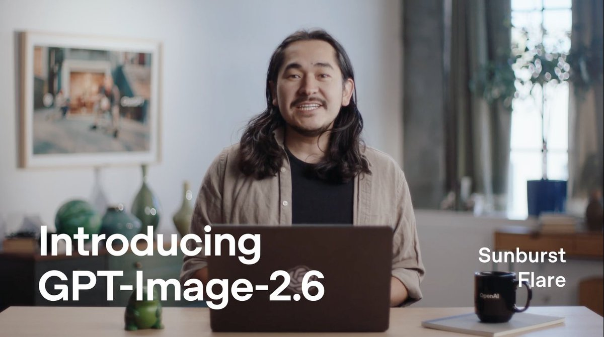 |

来源：[OpenAI 帖](https://x.com/OpenAI/status/2118124944928432327) · [OpenAIDevs 帖](https://x.com/OpenAIDevs/status/2118124753340756055)（2026-11-04）

---


### 30. 社区 · Flare 后空翻 GIF × 三档 complexity（@gabrielchua）

作者用 **GPT Image 2.6 Flare** 生成站立后空翻循环，并并排对比 low / medium / high complexity；OpenAIDevs 曾转发。

**提示词（原帖可见简短版）**：

```text
create a GIF of a man doing a standing backflip
```

| 预览静帧 | 并排对比动图镜像 |
|:--------:|:----------------:|
| 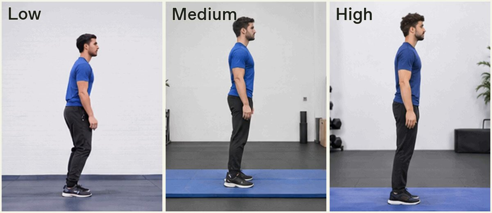 | 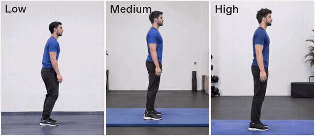 |

来源：[X 原帖 @gabrielchua](https://x.com/gabrielchua/status/2118135343354720648)（2026-11-05）

---

### 31. 社区 · 超现实灰度人脸弹跳 GIF（@tianmakibo）

作者明确用 Image 2.6 测 GIF；原帖未公开完整提示词。

**提示词未公开**（见原帖）。

| 静帧拼图 | GIF 镜像 |
|:--------:|:--------:|
| 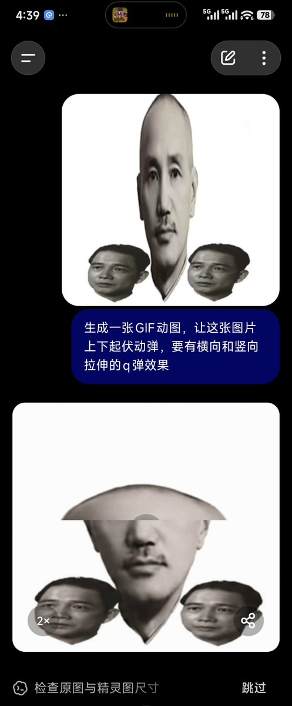 | 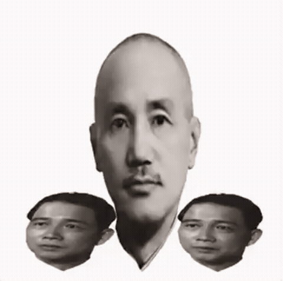 |

来源：[X 原帖 @tianmakibo](https://x.com/tianmakibo/status/2118263296520519786)（2026-11-05）

---

### 32. 社区 · 夏日元气少女花园喷水 GIF（@nima2qisi2）

作者在评论区给出完整指令；**需自备服装参考图**（提示词写「穿着参考图中的…」）。

**提示词（作者评论区原文）**：

```text
请以这个内容创建一个 GIF，内容是： # JAPANESE SUMMER｜夏日元气少女
**10秒日系青春活力MV视频提示词**

**画面规格：** 9:16 竖屏，10秒，30fps，写实摄影质感。

**人物设定：**
22岁成年东亚女性，清透冷白皮肤，短款深棕色波波头，轻薄空气刘海，五官甜美可爱，身材匀称。穿着参考图中的蓝色泳装、黄色镂空针织罩衫及牛仔短裤。人物保持统一，性格活泼俏皮，笑容自然，有青春少女的灵动感。

**整体风格：**
Japanese Youth MV / Japanese Summer Pop / Youthful Cinematic Montage。

明亮通透的夏日阳光，翠绿花园，蓝色天空，橙色充气泳圈，水花飞溅。采用日本青春电影式混剪，快速切换全景、中景、近景和人物特写。画面具有轻微胶片颗粒、柔和高光、自然镜头运动。

### 01｜10秒分镜设计

**0—1.2秒｜开场钩子**
低机位快速推进，女主坐在橙色充气泳圈上，双手拿着水枪，突然发现镜头，露出惊喜的笑容，水流突然朝镜头喷来。

**1.2—2.4秒｜俏皮特写**
快速硬切面部近景，女主被水花溅到，轻轻眯眼，随后露出调皮笑容，发丝随着动作轻轻晃动。阳光在脸颊形成漂亮的光斑。

**2.4—3.6秒｜青春动态**
侧面低机位，女主赤脚轻轻踢起草坪上的水花，镜头快速横向跟拍，橙色泳圈在前景掠过，形成自然遮挡转场。

**3.6—4.8秒｜视觉节奏**
俯拍镜头，女主拿着水枪在草坪上转身，水流划出弧线。镜头快速向下俯冲，再跟随水花向上抬起。

**4.8—6.0秒｜少女感特写**
正面近景，女主双手举起水枪，突然向镜头喷水，水珠在阳光下形成晶莹的高光，女主笑着躲避镜头。

**6.0—7.3秒｜活力爆发**
快速硬切至侧后方，女主从泳圈上轻巧起身，转身甩动头发，黄色针织罩衫随动作自然摆动，镜头进行半圈快速环绕。

**7.3—8.7秒｜夏日氛围**
广角镜头，女主在草坪上轻快地转圈，双手张开，阳光穿过树叶洒落，水花从前景飞过，画面充满夏日青春气息。

**8.7—10秒｜记忆点结尾**
突然切换正面近景，女主向镜头靠近，俏皮地歪头眨眼，随后拿起水枪再次喷水，水花覆盖整个镜头，最后定格在明亮的白色水花中。

### 02｜音乐与剪辑

原创日系青春J-POP配乐：
- 轻快的电吉他、明亮合成器、活泼贝斯与清脆鼓点。
- 约155—165 BPM，具有夏日偶像MV的轻盈节奏。
- 开场直接进入音乐，不要冗长铺垫。
- 每次鼓点配合一次硬切或动作变化。
- 中间加入少量0.3—0.5秒高速慢动作水花特写，再迅速恢复正常速度。
- 结尾音乐与水花覆盖镜头同步收束。

### 03｜摄影与画面约束

1. 混剪必须具有明显的景别变化，避免全程一个机位。
2. 人物始终是画面视觉中心，保持同一张脸、发型和服装。
3. 人物动作自然轻快，表情丰富，笑容甜美但不过度表演。
4. 保留真实皮肤纹理、自然阳光与水珠物理效果。
5. 镜头切换干净利落，利用水花、泳圈和人物动作完成匹配剪辑。
6. 不要广告片质感，不要商业产品展示，不要字幕、文字、Logo、水印。
7. 避免人物变脸、服装改变、手指畸形、肢体错位及水枪结构变形。

**最终效果：像一支10秒的日本夏日青春偶像MV，轻松、明亮、活泼、俏皮，让人感受到夏天的快乐。**

```

| 静帧 | GIF 镜像 |
|:----:|:--------:|
| 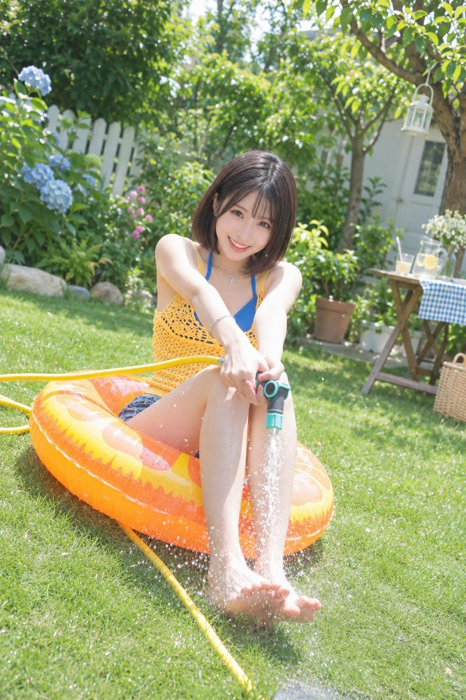 | 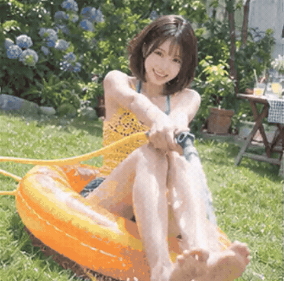 |

来源：[X 原帖](https://x.com/nima2qisi2/status/2118150226330734787) · [提示词评论](https://x.com/nima2qisi2/status/2118150229811920912)（2026-11-05）

---

### 33. 社区 · 白宫外观 360° 环绕 GIF（@nima2qisi2）

**提示词（原帖原文）**：

```text
【白宫外观】360°环绕
帮我做一个真实白宫外观的360°环绕模仿无人机拍摄，要真实还原建筑环境的实际外观情况，做成gif
```


来源：[X 原帖 @nima2qisi2](https://x.com/nima2qisi2/status/2118295936606798006)（2026-11-05）

---

### 34. 社区 · Q 版反应表情包模板（@0xluffy_eth）

可复用表情包提示词；**需自备角色参考图**。

**提示词（作者原文）**：

```text
请以我上传的角色图为参考，按「表情包主题」做一张可下载的动态 GIF。

【角色保持一致】锁发型/配色/标志道具，Q 版比例全帧不变
【自动设计动作】一个核心笑点，夸张一点，首尾能循环
【自动配字】2～8 个字网感短句，顶部粗圆体+白描边
【画面】正方形纯白底，2～3 秒循环，聊天表情包规格

表情包主题：【填你的梗，比如「周一不想上班」】
```


来源：[X 原帖 @0xluffy_eth](https://x.com/0xluffy_eth/status/2118235544459387112)（2026-11-05）

---

### 35. 社区 ·「真香！」吃白饭表情 GIF（@Gorden_Sun）

**需角色参考图**（作者附参考静帧）。

**提示词（原帖原文）**：

```text
使用这个角色，生成一张GIF图，内容是她吃大白米饭，图片里有文字：真香！
```

| 参考图 | GIF 镜像 |
|:------:|:--------:|
| 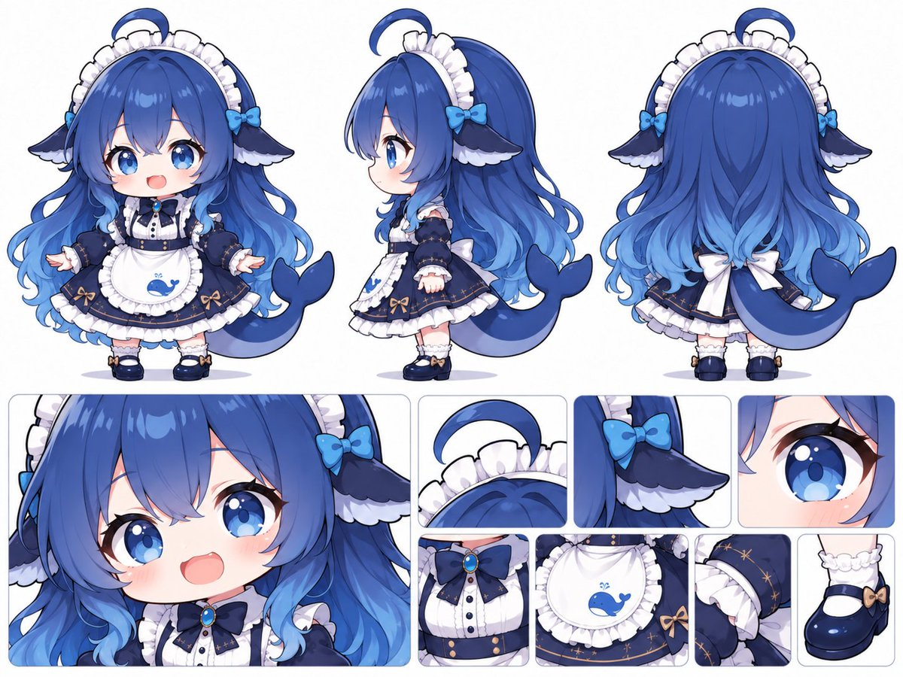 |  |

来源：[X 原帖 @Gorden_Sun](https://x.com/Gorden_Sun/status/2118166046175908016)（2026-11-05）

---

### 36. 社区 · 像素风角色待机/攻击循环（@LerSentAI）

作者自称 Image 2.6 直出多角度待机与攻击动作；原帖未公开完整提示词。

**提示词未公开**（见原帖）。

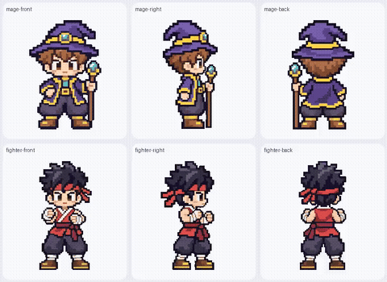

来源：[X 原帖 @LerSentAI](https://x.com/LerSentAI/status/2118173626424025414)（2026-11-05）

---

### 37. 社区 · 绿色大帽子角色读报循环（@testingcatalog）

标注 Made with ChatGPT Images 2.6 for testing；原帖未公开提示词。

**提示词未公开**（见原帖）。

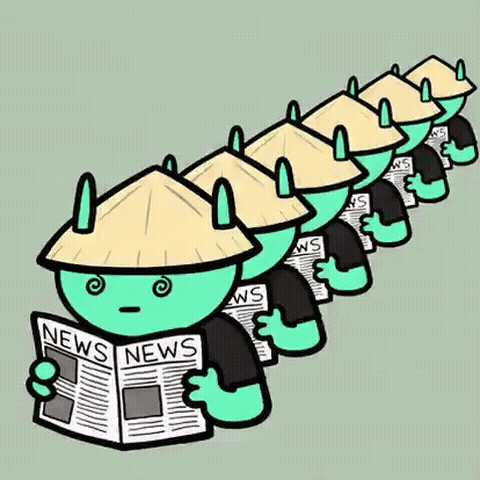

来源：[X 原帖 @testingcatalog](https://x.com/testingcatalog/status/2118138826212385225)（2026-11-05）

---

### 38. 社区 · 角色心跳舞 low/medium/high（@Mayz1169）

作者称用 Codex + Image 2.6 让角色做 heartbeat dance，并排三档。

**提示词见原帖（简短说明，非逐步参数）**：原帖写 “make my character do a heartbeat dance”，完整工程提示未公开。

| 预览 | 片段镜像 |
|:----:|:--------:|
| 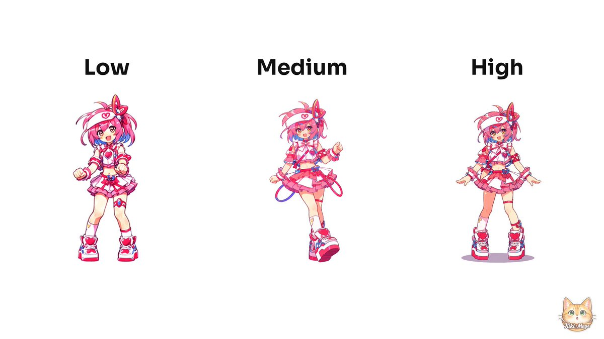 | 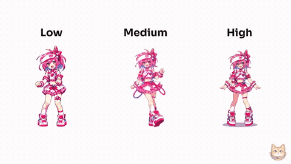 |

来源：[X 原帖 @Mayz1169](https://x.com/Mayz1169/status/2118241781074862569)（2026-11-05）

---

### 39. 社区 · 黑色连体衣棚拍时尚人像（@aisumeragi）

作者称用 ChatGPT Image 2.6 约 30 秒生成时尚人像展示。

**提示词未公开**（见原帖）。

| 预览 |
|:----:|
|  |

来源：[X 原帖 @aisumeragi](https://x.com/aisumeragi/status/2118188273134915596)（2026-11-05）

---

### 40. 社区 · 奶油团子日常表情 GIF（@Leviwoyun）

作者用 GPT Images 2.6 做表情包动图合集展示。

**提示词未公开**（见原帖）。

| 静帧 | GIF 镜像 |
|:----:|:--------:|
| 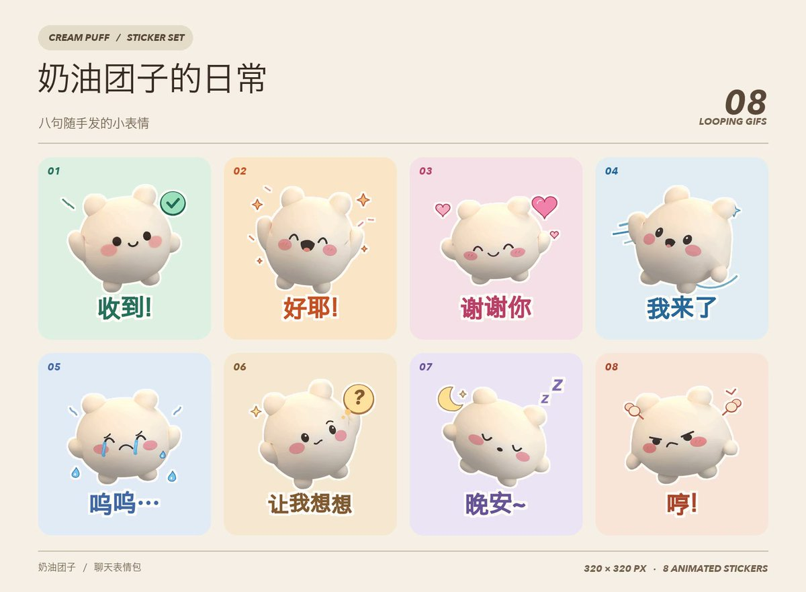 | 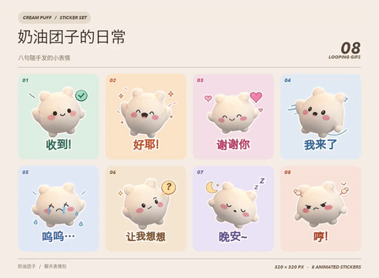 |

来源：[X 原帖 @Leviwoyun](https://x.com/Leviwoyun/status/2118157743840469222)（2026-11-05）

---

### 41. 社区 · 蓝发女仆 / 大肥鱼反应表情 GIF（@op7418）

作者用 GPT-image-2.6 直出 GIF 表情包，并在回复中公开完整模板（需上传角色参考图）。

**提示词（作者回复原文）**：

```text
请以我上传的大肥鱼图片为角色和画风参考，根据最后一行的「表情包主题」，直接制作一张可下载的动态 GIF 表情包。

【角色保持一致】
保留参考图中的蓝色渐变长发、呆毛、鲸鱼耳鳍、蓝色蝴蝶结、白色女仆头饰、蓝白女仆裙和大鲸鱼尾巴。
保持原图的大头小身体 Q 版比例、圆脸和可爱画风，人物外观在所有帧中保持一致。

【自动设计动作】
理解我想表达的情绪或梗，将它设计成一个简单、有趣、一眼能看懂的短动作。
突出一个核心笑点，用夸张表情、动作反差和轻微的压缩回弹增加喜感。头发、呆毛、耳鳍和尾巴自然跟随动作。
根据主题添加必要的少量道具，保持画面简洁。
主动设计首尾衔接，让动画能够自然循环播放。

【自动配字】
根据主题提炼一句简短、有网感的中文配字，优先控制在 2～8 个字。
如果主题中用引号指定了台词，直接使用该台词。
字幕放在顶部，使用粗圆体、深蓝字、白色描边；文字、字形和位置全程稳定，角色与道具不遮挡字幕。

【画面与输出】
正方形画面，纯白背景，固定镜头，主体居中并保留足够边距。
动画约 2～3 秒，无限循环，动作清晰，适合聊天时作为表情包发送。
最终交付实际会播放的多帧 GIF 文件，并提供下载。

表情包主题：【在这里填一句话，描述你想表达的梗、情绪或动作】
```

| 参考图 | GIF 示例 |
|:------:|:--------:|
|   |   |

来源：[X 原帖 @op7418](https://x.com/op7418/status/2118181775688241456) · [提示词回复](https://x.com/op7418/status/2118181972451438662)（2026-11-05）

---

### 42. 社区 · 阳光花园动漫情侣连续编辑（@k_matsumaru）

作者用 GPT Image 2.6（Flare 起始）测试多轮编辑一致性，附对比视频。

**提示词未公开**（见原帖）。

| 预览 |
|:----:|
|  |

来源：[X 原帖 @k_matsumaru](https://x.com/k_matsumaru/status/2118186638228816322)（2026-11-05）

---

### 43. 社区 · 橙色放射背景眼镜男肖像循环 GIF（@CuiMao）

作者标注 “GPT image 2.6 test” 的循环肖像 GIF。

**提示词未公开**（见原帖）。

| GIF 镜像 |
|:--------:|
|  |

来源：[X 原帖 @CuiMao](https://x.com/CuiMao/status/2118271313764925886)（2026-11-05）

---

### 44. 社区 · Q 版角角女孩华丽礼服舞蹈 GIF（@798145343h）

作者测试 Image 2.6 直出 GIF，做了成对舞蹈循环。

**提示词未公开**（见原帖）。

| GIF 1 | GIF 2 |
|:-----:|:-----:|
|  |  |

来源：[X 原帖 @798145343h](https://x.com/798145343h/status/2118164732989608405)（2026-11-05）

---

### 45. 社区 · 彩色花朵环绕宣传标题卡（@vikktorrrre）

作者称 “1 prompt and Images 2.6 made this”。

**提示词未公开**（见原帖）。

| 预览 |
|:----:|
|  |

来源：[X 原帖 @vikktorrrre](https://x.com/vikktorrrre/status/2118128944058716210)（2026-11-04）

---

### 46. 社区 · 原生 GIF 实为 Sprite Sheet 裁切（@Mashiro_0619）

作者拆解 GPT Image 2.6 原生 GIF：先画 3×3 精灵表再硬缝成动图，并晒出精灵表截图。

**提示词未公开**（见原帖；本条侧重机制观察）。

| 精灵表示意 |
|:----------:|
| 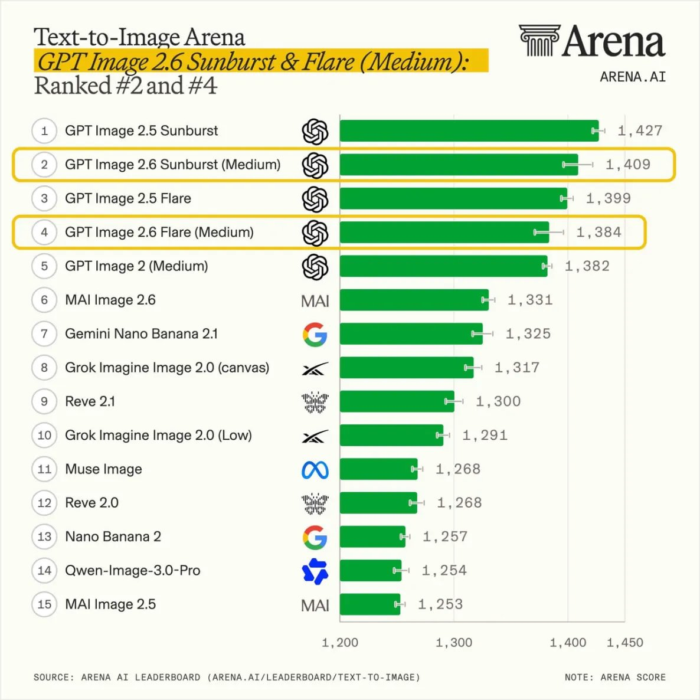 |

来源：[X 原帖 @Mashiro_0619](https://x.com/Mashiro_0619/status/2118216167613685875)（2026-11-05）

---

### 47. 社区 · 门镜 / 对讲监视器视角角色（@kabumira862571）

作者公开 GPT-Image 2.6 提示词模板（上传角色图）。

**提示词（原帖原文）**：

```text
＊＊＊を“ドアスコープ”か“インターホン室内モニター”にしてください

Prompt（画像アップロード）：
玄関先でこちらを見るキャラ。
[＊＊＊]
キャラは、アップロード画像を参照。
顔・髪型・服装まで忠実に再現。
晴れた住宅街、自然光。
アスペクト比縦4:5。
```

| 示例 1 | 示例 2 |
|:------:|:------:|
| 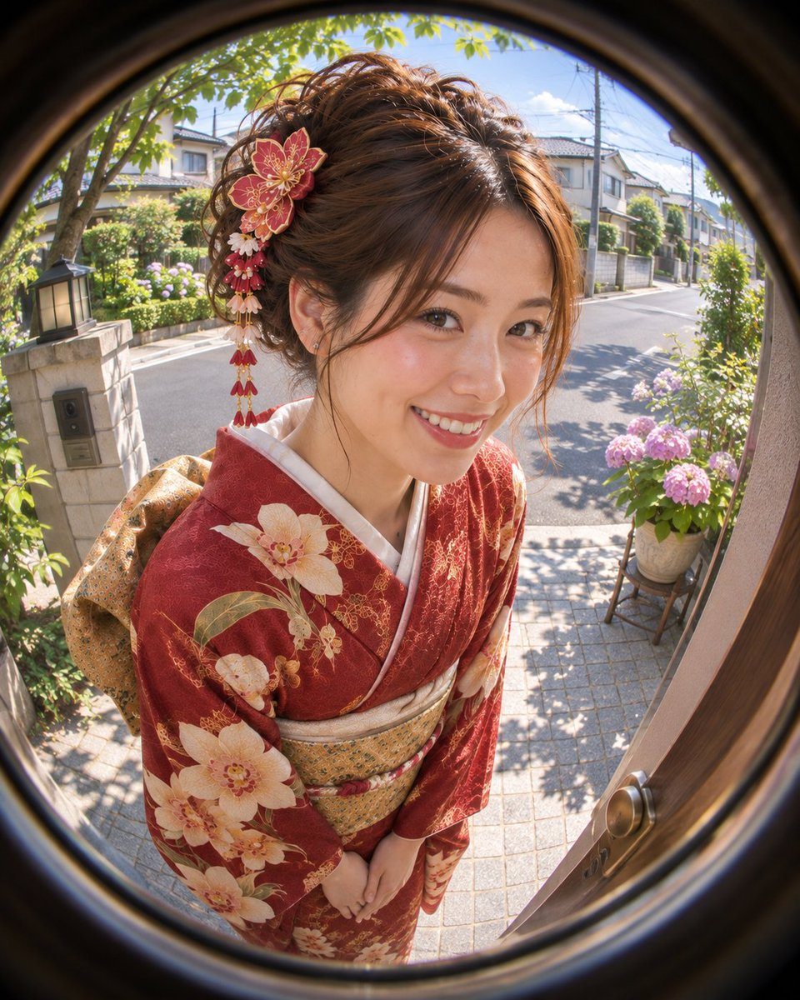 | 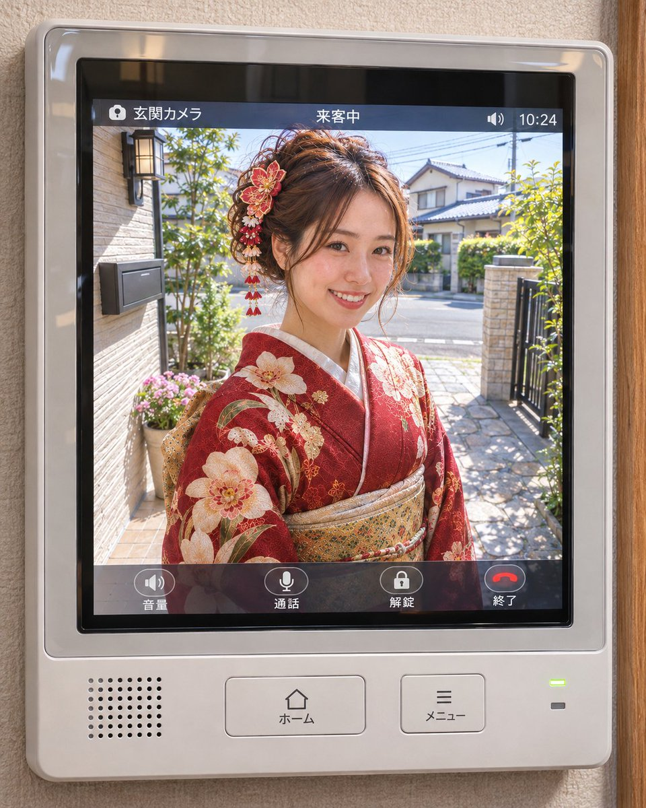 |

来源：[X 原帖 @kabumira862571](https://x.com/kabumira862571/status/2118220107487051883)（2026-11-05）

---

### 48. 社区 · RAM trap 迷因 GIF（@HarshithLucky3）

作者称首次用 GPT image 2.6 做 RAM trap meme。

**提示词未公开**（见原帖）。

| GIF 镜像 |
|:--------:|
| 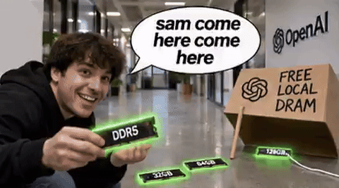 |

来源：[X 原帖 @HarshithLucky3](https://x.com/HarshithLucky3/status/2118224963362779373)（2026-11-05）

---

### 49. 社区 · RETO 3D 相机效果尝试（@okl0ok）

作者用 GPT Image 2.6 尝试 RETO 3D 相机观感（自称未完全成功）。

**提示词未公开**（见原帖）。

| GIF 镜像 |
|:--------:|
| 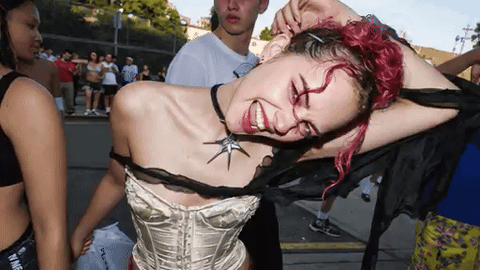 |

来源：[X 原帖 @okl0ok](https://x.com/okl0ok/status/2118230434207400329)（2026-11-05）

---

### 50. 社区 · 花园橘猫肖像加抚摸动作 GIF（@luowj_wxy）

作者演示用 GPT-Image 2.6 Flare/Sunburst 把静图变成轻微动作 GIF。

**提示词见原帖**（简述：保留构图，让女生轻轻抚摸猫头）。

| 静帧 | GIF |
|:----:|:---:|
| 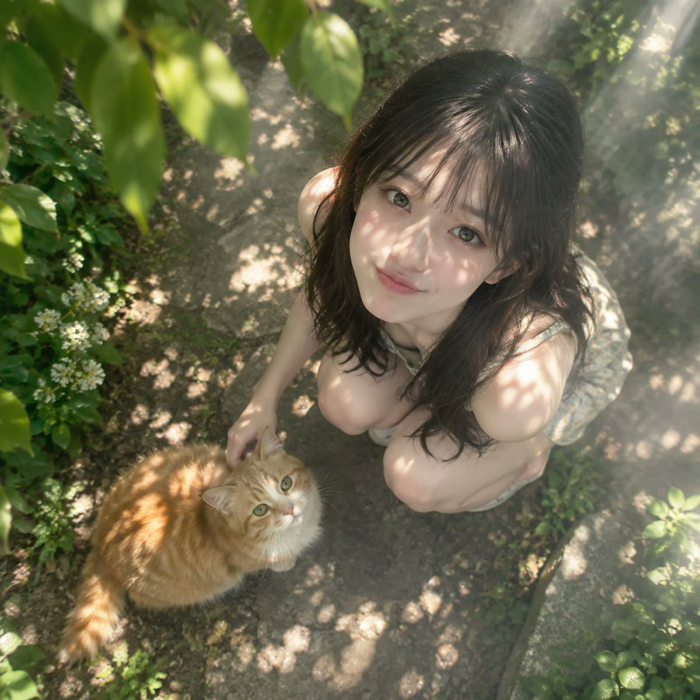 | 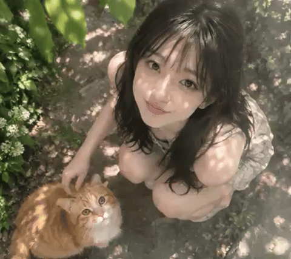 |

来源：[X 原帖 @luowj_wxy](https://x.com/luowj_wxy/status/2118231871381471707)（2026-11-05）

---

### 51. 社区 · 六宫格关键帧「自作聪明」对比（@Sirilee2026）

作者用 `gpt-image-2.6-sunburst` 做视频关键帧六宫格，展示模型擅自改版式后的结果，并与 2.5 对照。

**提示词见原帖**（要求六宫格关键帧；完整参数未全文公开）。

| 2.6 结果 1 | 2.6 结果 2 | 对照 |
|:----------:|:----------:|:----:|
| 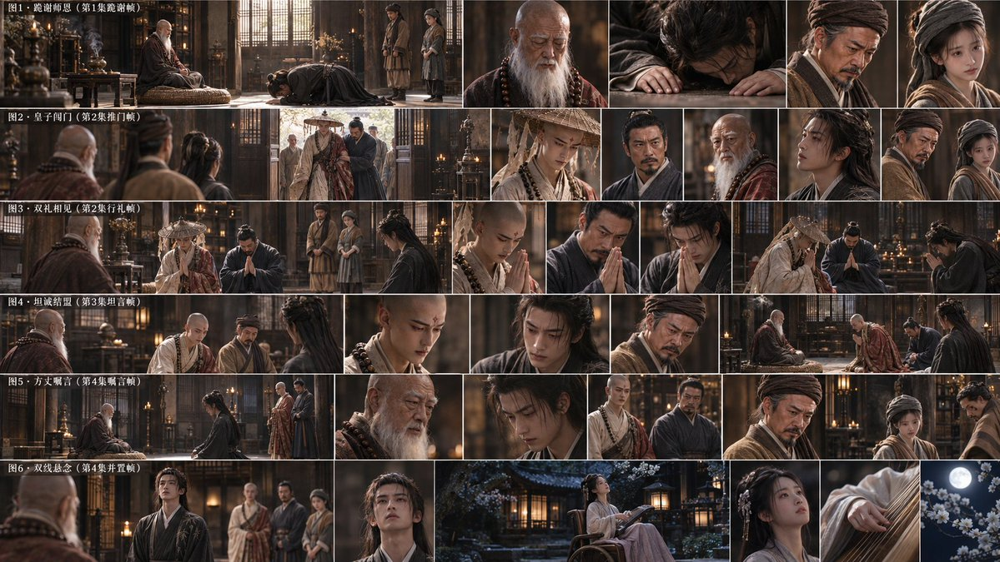 | 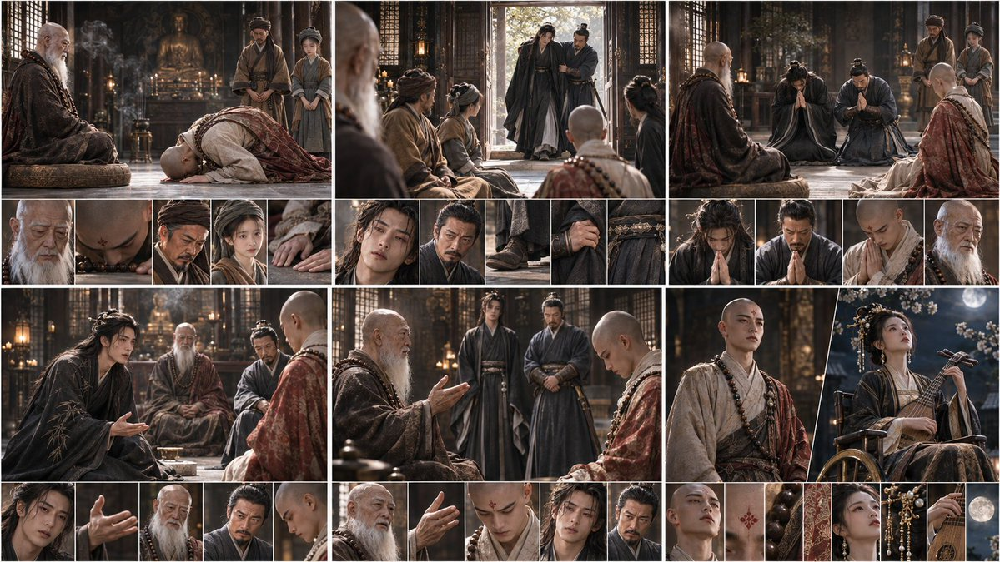 | 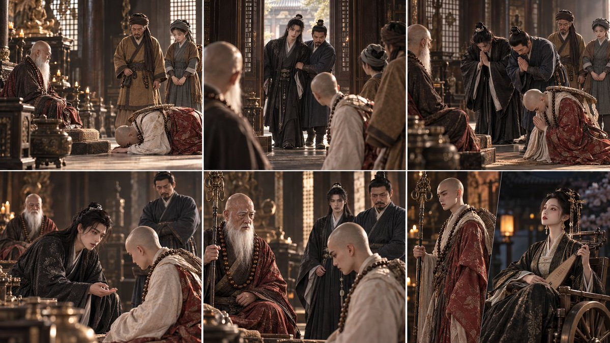 |

来源：[X 原帖 @Sirilee2026](https://x.com/Sirilee2026/status/2118236882656239715)（2026-11-05）

---

### 52. 社区 ·「平成」主题 SNS GIF（@rem_rev）

作者公开短提示词，用 ChatGPT Images 2.6 生成 SNS 向 GIF。

**提示词（原帖原文）**：

```text
平成を象徴する何か。SNS向けのGIF画像を生成して下さい。
```

| GIF 镜像 |
|:--------:|
| 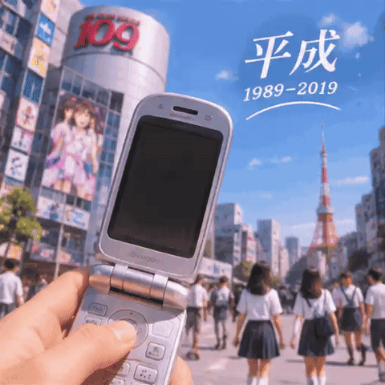 |

来源：[X 原帖 @rem_rev](https://x.com/rem_rev/status/2118252486360498485)（2026-11-05）

---

### 53. 社区 · 同提示词 Flare / Sunburst 对比四连（@VIBEQUIRKLABS）

作者同一提示分别跑 GPT-Image-2.6 / Flare / Sunburst，展示差异（提示词正文未公开）。

**提示词未公开**（见原帖）。

| 1 | 2 | 3 | 4 |
|:-:|:-:|:-:|:-:|
| 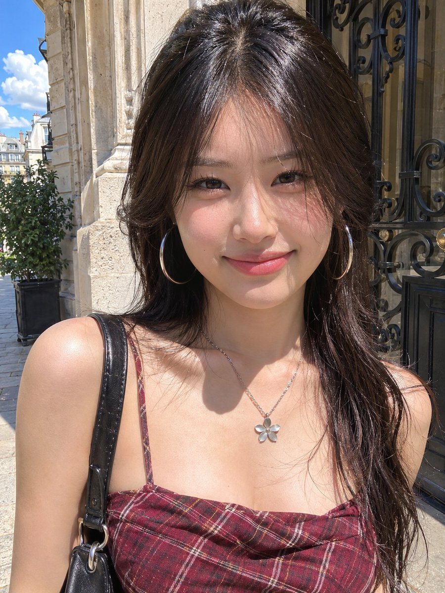 | 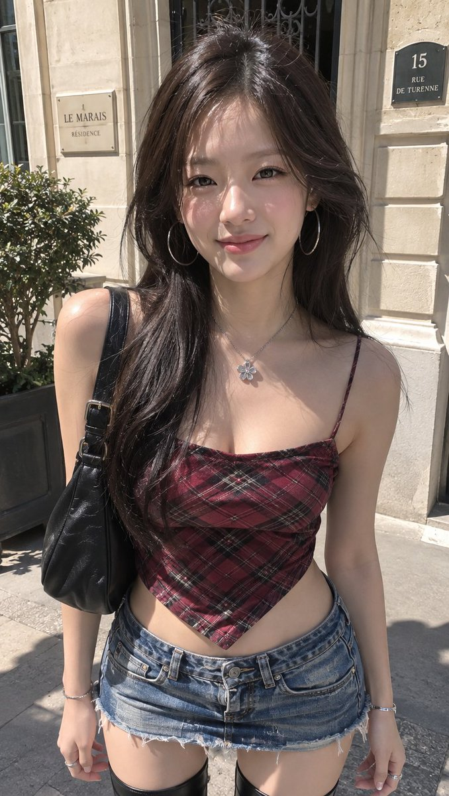 | 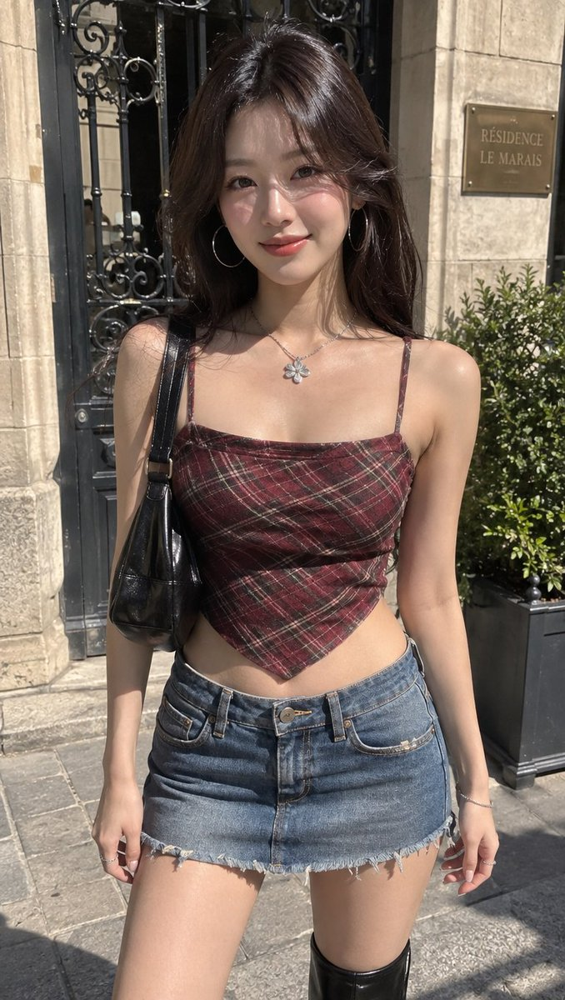 | 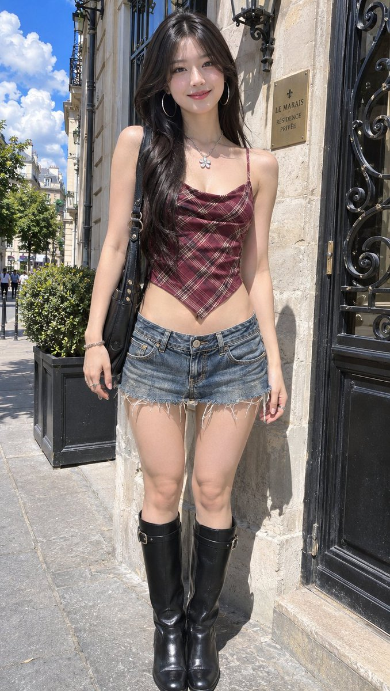 |

来源：[X 原帖 @VIBEQUIRKLABS](https://x.com/VIBEQUIRKLABS/status/2118223384198926432)（2026-11-05）

---

### 54. 社区 · Sunburst 原生 GIF vs 合成 GIF（@coldmountainlab）

作者对比 API 原生 GIF（512×512、16 帧）与「先出动作帧再合成」两种路径。

**提示词未公开**（见原帖；标注 #GPTImage）。

| 对比动图镜像 |
|:------------:|
| 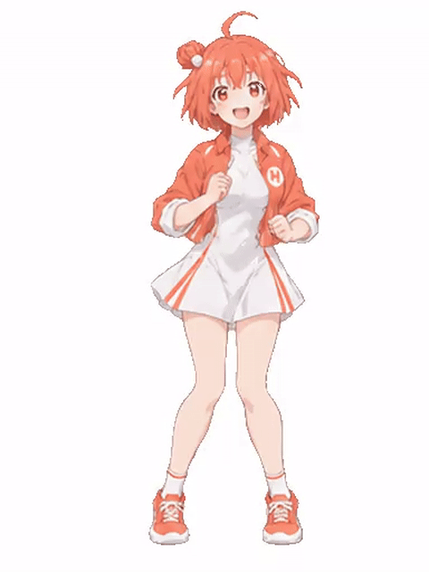 |

来源：[X 原帖 @coldmountainlab](https://x.com/coldmountainlab/status/2118249456487277046)（2026-11-05）

---

### 55. 社区 · ChatGPT Image 2.6 GIF 稳定性测试（@daaihq）

作者测试 ChatGPT image 2.6 GIF，认为单张更稳、批量仍易崩。

**提示词未公开**（见原帖）。

| GIF 1 | GIF 2 |
|:-----:|:-----:|
| 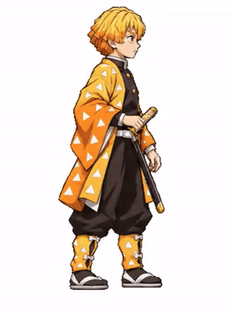 | 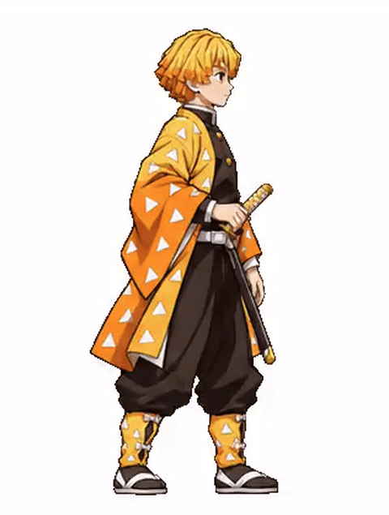 |

来源：[X 原帖 @daaihq](https://x.com/daaihq/status/2118250539670794442)（2026-11-05）

---

### 56. 社区 · GIF / SVG 样例合集（@Aliadafu）

作者展示 Image 2.6 直出 GIF 与 SVG 相关样例。

**提示词未公开**（见原帖）。

| 样例 |
|:----:|
| 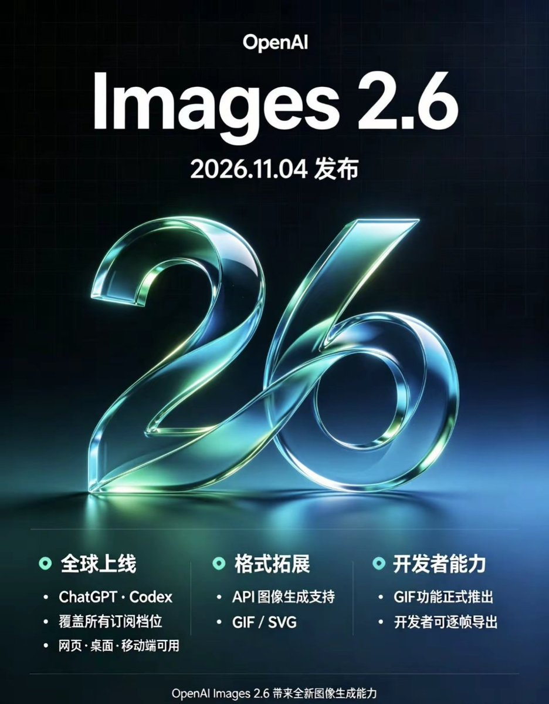  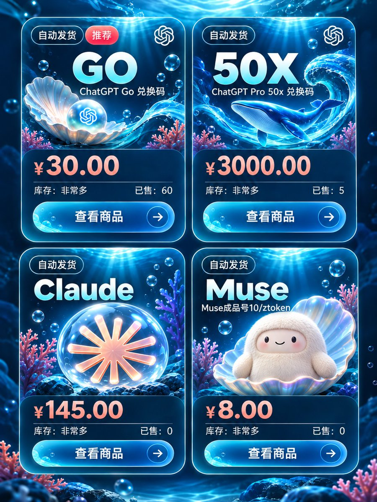 |

来源：[X 原帖 @Aliadafu](https://x.com/Aliadafu/status/2118242049787093361)（2026-11-05）

---

### 57. 社区 · 复古街机格斗角色动作 GIF（@xiaomovps）

作者用 Images 2.6 生成 16-bit 街机格斗素材，并做成出拳等循环 GIF。

**提示词未公开**（见原帖）。

| GIF 1 | GIF 2 | 静帧 |
|:-----:|:-----:|:----:|
| 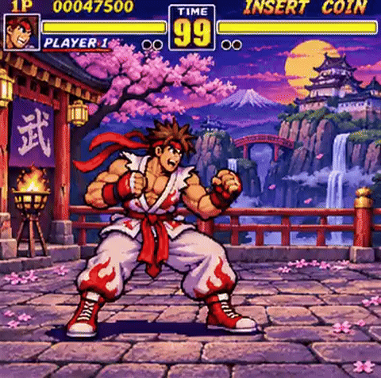 | 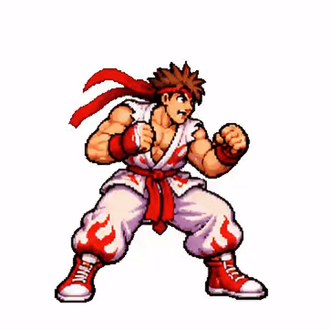 | 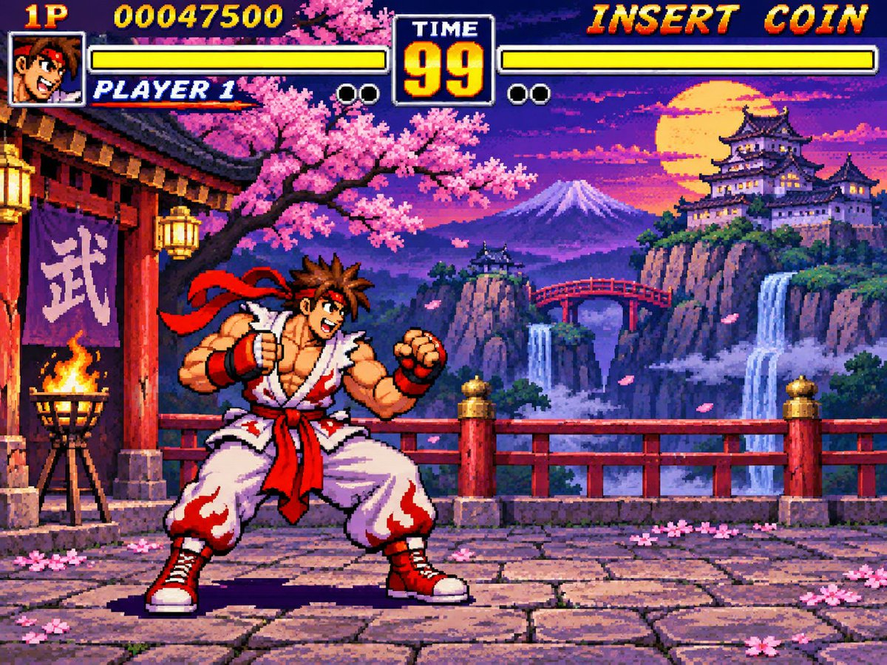 |

来源：[X 原帖 @xiaomovps](https://x.com/xiaomovps/status/2118274032227471705)（2026-11-05）

---

### 58. 社区 · 参考图 + 日程定时角色消息（@elle_elle_e）

作者演示 Images 2.6 参考图注册，并与 ChatGPT 日程组合（UI 截图）。

**提示词见原帖**（日程模板含 `REFERENCE_NAME` / `CHARACTER` 占位）。

| 截图 |
|:----:|
| 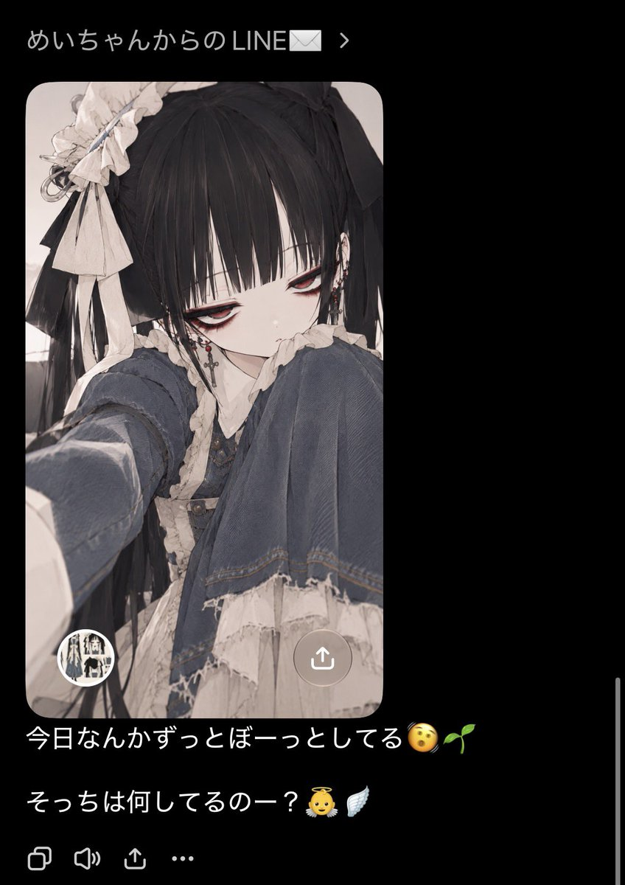 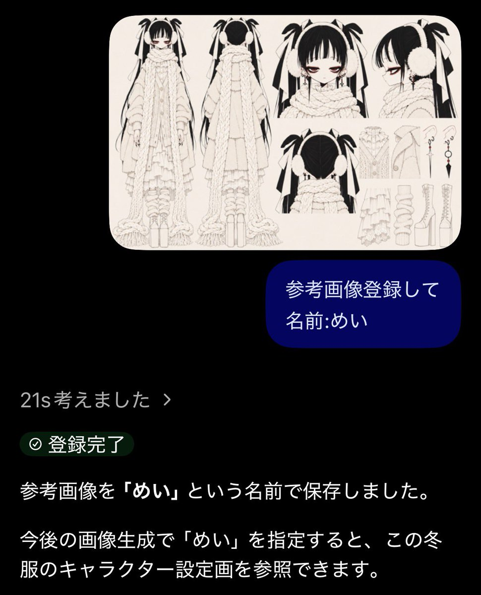 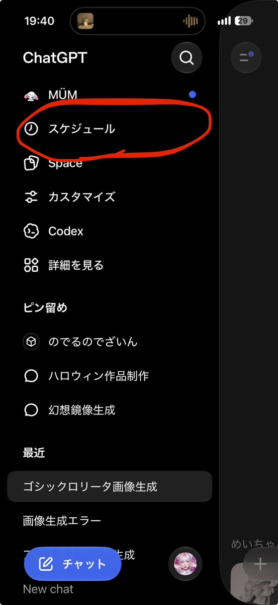 |

来源：[X 原帖 @elle_elle_e](https://x.com/elle_elle_e/status/2118293441751007660)（2026-11-05）

---

### 59. 社区 · 蓝色大肥鱼 GIF 表情包（@lixinbao_X）

作者用 Images 2.6 / Flare·Sunburst 叙事，展示大肥鱼动态表情。

**提示词未公开**（见原帖）。

| 静帧 | GIF |
|:----:|:---:|
|   |   |

来源：[X 原帖 @lixinbao_X](https://x.com/lixinbao_X/status/2118253929222029694)（2026-11-05）

---

### 60. 社区 · Markup 红圈局部重着色模板（@just_v3ra）

作者整理 Images 2.6 API markup 局部编辑提示模板（配示意图）。

**提示词（原帖原文模板）**：

```text
Recolor the [object] inside the red circle to [new look].
Keep [what must stay] and the rest of the image unchanged.
Remove the red circle from the finished image.
```

| 示意 |
|:----:|
|  |

来源：[X 原帖 @just_v3ra](https://x.com/just_v3ra/status/2118243623300993210)（2026-11-05）

---

### 61. 社区 · Chibi 角色多视角设定表（@CodeByNZ）

作者在 Higgsfield 上用 ChatGPT Images 2.6 做大头 chibi 肖像与正/背/侧设定。

**提示词未公开**（见原帖）。

| 设定表 |
|:------:|
|     |

来源：[X 原帖 @CodeByNZ](https://x.com/CodeByNZ/status/2118307616115802431)（2026-11-05）

---

### 62. 社区 · Images 2.6 GIF + 参考图功能演示（@hikawoai）

作者介绍 Images 2.6 的 GIF 与参考图调用，并附演示动图。

**提示词未公开**（见原帖）。

| 静帧 | GIF |
|:----:|:---:|
|  |  |

来源：[X 原帖 @hikawoai](https://x.com/hikawoai/status/2118316299604668885)（2026-11-05）

---

### 63. 社区 · 官方 6 帧分镜 GIF 写法拆解（@HappyS6688）

作者拆解 Images 2.6 官方示例的 6 帧分镜写法，并给出可复用模板。

**提示词模板（原帖）**：

```text
做一张循环 GIF 用的 6 帧分镜图，3 列 2 行、每格同尺寸。[角色]在[场景]里，先[动作1]，再[动作2]，最后[动作3]，第 6 帧自然过渡回第 1 帧。固定机位，角色、服装、背景不变。不要文字、边框和格子线。
```

| 配图 |
|:----:|
|   |

来源：[X 原帖 @HappyS6688](https://x.com/HappyS6688/status/2118319539498758475)（2026-11-05）

---

### 64. 社区 · 六种材质无限循环 GIF 合集（@atlante83）

作者用 ChatGPT Images 2.6 做毡布、剪纸、riso、像素、Y2K、粘土等六种风格无限循环。

**提示词未公开**（见原帖）。

| 静帧 | 合集动图镜像 |
|:----:|:------------:|
|  |  |

来源：[X 原帖 @atlante83](https://x.com/atlante83/status/2118241280543047702)（2026-11-05）

---

### 65. 社区 · ChatGPT 免费档循环 GIF 入门（@kel_ruael）

作者介绍 Images 2.6 免费档做循环 GIF 的步骤卡（配图）。

**提示词见原帖回复**（主帖为步骤导引）。

| 配图 |
|:----:|
|  |

来源：[X 原帖 @kel_ruael](https://x.com/kel_ruael/status/2118248382091403387)（2026-11-05）

---

### 66. 社区 · ChatGPT App 内 Logo / 平面测试（@creatortray）

作者在 ChatGPT App 测试 Image 2.6，展示多张生成结果，并点评 Logo/平面设计仍需打磨。

**提示词未公开**（见原帖）。

| 样例 |
|:----:|
|     |

来源：[X 原帖 @creatortray](https://x.com/creatortray/status/2118221750203031897)（2026-11-05）

---

### 67. 社区 · 雷霆视角 POV 自拍提示词（@johnAGI168）

作者公开完整 ChatGPT Images 2.6 英文提示词并附生成图。

**提示词（原帖原文）**：

```text
雷霆视角📷

ChatGPT Images 2.6 prompt 👇

A crisp, high-fidelity vertical POV selfie photograph captured from an extreme high angle with a 20mm ultra-wide lens perspective — looking straight down at an exceptionally gorgeous young East Asian woman standing in her bedroom, her outstretched arm framing the upper corner.

She possesses elite influencer beauty, wavy dark brown hair with see-through air bangs, light gray-green contact lenses, a tiny beauty mark beneath her right eye, igari-style pink blushed cheeks, and glossy lips. She has a slender hourglass figure, wearing a tight white scoop-neck cropped short-sleeve tee, black retro dolphin shorts with white piped edges and a front drawstring, and glossy black patent leather pointed-toe stiletto pumps on her bare feet.

The room features light oak hardwood flooring, soft cream curtains, and a white bed edge softly blurred in the background. Clean, diffuse indoor overhead ambient lighting illuminates her features naturally, casting gentle, physically accurate contact shadows beneath her heels.

Captured with natural wide-angle perspective stretching height from head to feet, with deep depth of field and fine organic 35mm grain. Authentic skin texture with delicate pores, biological warmth, realistic cotton fabric stretch, and crisp patent leather reflections — strictly no CGI, no 3D render, no plastic skin, no artificial smoothing, no waxy AI look.
```

| 预览 |
|:----:|
|  |

来源：[X 原帖 @johnAGI168](https://x.com/johnAGI168/status/2118247837683044650)（2026-11-05）

---

### 68. 社区 ·「收到」社畜表情 GIF（@Savannahgm7r）

作者用 Images 2.6 做工作群「收到」配精神状态的 GIF。

**提示词未公开**（见原帖）。

| GIF 镜像 |
|:--------:|
|  |

来源：[X 原帖 @Savannahgm7r](https://x.com/Savannahgm7r/status/2118253296632967463)（2026-11-05）

---


## 整合图库：全部素材与提示词

本节按 GitHub Pages 图库顺序列出全部 92 个案例。素材文件位于 `docs/gallery/assets/media/`；提示词仅展示仓库已收录或来源公开的内容，未公开部分明确标注，不补写未经核实的提示词。

### 1. 为 SVG 火柴人更换颜色
- 分类：图标与 SVG
- 模型标注：`gpt-2.6`
- 原始来源：[查看案例](https://x.com/higgsfield_ai/status/2118149257140306238)

**素材**


[视频素材：svg-1.mp4](docs/gallery/assets/media/svg-1.mp4)

**提示词**

```text
上传火柴人 SVG，保留人物轮廓、动作和背景，将围巾改为鲜红色。输出可编辑 SVG；如需动画，请分别提供静态矢量素材与动画实现方案。
```


### 2. 制作像素游戏角色动作
- 分类：游戏与互动
- 模型标注：`gpt-2.6`
- 原始来源：[查看案例](https://x.com/higgsfield_ai/status/2118152815625552235)

**素材**


[视频素材：sprites-1.mp4](docs/gallery/assets/media/sprites-1.mp4)

**提示词**

```text
设计横版像素游戏素材：废品场背景、机器人角色，以及待机、行走、攻击动作的逐帧精灵表。统一像素尺寸、调色板和角色比例，透明背景导出角色素材。
```


### 3. 设计月球种花小游戏
- 分类：游戏与互动
- 模型标注：`gpt-2.6`
- 原始来源：[查看案例](https://x.com/Picsart/status/2118327473813205154)

**素材**


**提示词**

```text
设计月球种花小游戏的视觉素材：宇航员角色、月面温室、种子到开花的生长阶段及操作按钮。采用统一游戏美术风格，并分别整理背景、角色、植物和界面素材。
```


### 4. 用动图预演角色动作
- 分类：动态与表情
- 模型标注：`gpt-2.6`
- 原始来源：[查看案例](https://x.com/mirochill/status/2118328887348191491)

**素材**


[视频素材：preview-1.mp4](docs/gallery/assets/media/preview-1.mp4)

**提示词**

```text
上传一张角色画面，生成短循环 GIF：角色轻轻眨眼并转头，回到初始姿势，镜头固定，保持人物身份、服饰与原画风格。
```


### 5. 制作人体呼吸系统图解
- 分类：知识与表达
- 模型标注：`gpt-2.6`
- 原始来源：[查看案例](https://x.com/MercyDeGreat/status/2118319217611055417)

**素材**


[视频素材：breathing-1.mp4](docs/gallery/assets/media/breathing-1.mp4)

**提示词**

```text
制作人体呼吸系统科普信息图，展示鼻腔、气管、肺和肺泡，并用箭头说明吸气路径。版式清晰、标签可读；专业结构和术语由人工复核。
```


### 6. 让角色动起来：大肥鱼表情包
- 分类：动态与表情
- 模型标注：`gpt-2.6`
- 原始来源：[查看案例](https://x.com/halozhangyu/status/2118327841410408546)

**素材**


[视频素材：fish-1.mp4](docs/gallery/assets/media/fish-1.mp4)


[视频素材：fish-2.mp4](docs/gallery/assets/media/fish-2.mp4)


[视频素材：fish-3.mp4](docs/gallery/assets/media/fish-3.mp4)


[视频素材：fish-4.mp4](docs/gallery/assets/media/fish-4.mp4)


[视频素材：fish-prompt-1.mp4](docs/gallery/assets/media/fish-prompt-1.mp4)


[视频素材：fish-prompt-2.mp4](docs/gallery/assets/media/fish-prompt-2.mp4)


[视频素材：fish-prompt-3.mp4](docs/gallery/assets/media/fish-prompt-3.mp4)


[视频素材：fish-prompt-4.mp4](docs/gallery/assets/media/fish-prompt-4.mp4)

**提示词**

```text
上传角色参考图，把角色制作成短循环表情 GIF：先低头，再抬头眨眼，表情夸张但可爱。保持发型、服装、线条和颜色一致，最后回到起始姿势。
```


### 7. 让角色跳舞
- 分类：动态与表情
- 模型标注：`gpt-2.6`
- 原始来源：[查看案例](https://x.com/798145343h/status/2118164732989608405)

**素材**


[视频素材：dance-1.mp4](docs/gallery/assets/media/dance-1.mp4)


[视频素材：dance-2.mp4](docs/gallery/assets/media/dance-2.mp4)

**提示词**

```text
上传角色立绘，制作简短循环舞蹈 GIF：左右轻摆、挥手，再回到起始姿势。镜头固定，保持角色服装、发型、比例和画风一致。
```


### 8. 将模糊标志转为矢量图
- 分类：图标与 SVG
- 模型标注：`gpt-2.6`
- 原始来源：[查看案例](https://x.com/EHuanglu/status/2118166856498638932)

**素材**


[视频素材：logo.mp4](docs/gallery/assets/media/logo.mp4)

**提示词**

```text
上传模糊的标志作为参考，先还原主要轮廓和配色，简化为适合缩放的几何形状，再输出可编辑 SVG。文字不清楚时保留空位并向我确认。
```


### 9. 将分镜与矢量素材用于动画
- 分类：游戏与互动
- 模型标注：`gpt-2.6`
- 原始来源：[查看案例](https://x.com/trymirage/status/2118132360248004683)

**素材**


[视频素材：storyboard.mp4](docs/gallery/assets/media/storyboard.mp4)

**提示词**

```text
围绕一个角色从房门走出并挥手的动作，先设计连续分镜与关键姿势；分别提供透明背景角色素材和场景。再说明如何在动画工具中组织图层与时间线。
```


### 10. 制作透明底角色与界面动效
- 分类：游戏与互动
- 模型标注：`gpt-2.6`
- 原始来源：[查看案例](https://x.com/Yur1freedom/status/2118161546845299177)

**素材**


[视频素材：ui-motion.mp4](docs/gallery/assets/media/ui-motion.mp4)

**提示词**

```text
设计一位透明背景的卡通角色及配套 UI 动效草稿：包含待机、点击反馈和成功状态。统一轮廓和配色，分别输出角色、按钮和关键帧；实际交互由代码实现。
```


### 11. 制作咖啡机图解并翻译
- 分类：知识与表达
- 模型标注：`gpt-2.6`
- 原始来源：[查看案例](https://developers.openai.com/api/docs/guides/image-prompting?model=gpt-image-2.6)

**素材**


**提示词**

```text
Create a detailed Infographic of the functioning and flow of an automatic coffee machine like a Jura.
From bean basket, to grinding, to scale, water tank, boiler, etc.
I'd like to understand technically and visually the flow.
```

```text
Translate the text in the infographic to Spanish. Do not change any other aspect of the image.
```


### 12. 移除人物手中花朵
- 分类：图片编辑
- 模型标注：`gpt-2.6`
- 原始来源：[查看案例](https://developers.openai.com/api/docs/guides/image-prompting?model=gpt-image-2.6)

**素材**


**提示词**

```text
Remove the flower from man's hand. Do not change anything else.
```


### 13. 绘本角色跨场景延续
- 分类：角色与故事
- 模型标注：`gpt-2.6`
- 原始来源：[查看案例](https://developers.openai.com/api/docs/guides/image-prompting?model=gpt-image-2.6)

**素材**


**提示词**

```text
Create a children’s book illustration introducing a main character.

Character:
A young, storybook-style hero inspired by a little forest outlaw,
wearing a simple green hooded tunic, soft brown boots, and a small belt pouch.
The character has a kind expression, gentle eyes, and a brave but warm demeanor.
Carries a small wooden bow used only for helping, never harming.

Theme:
The character protects and rescues small forest animals like squirrels, birds, and rabbits.

Style:
Children’s book illustration, hand-painted watercolor look,
soft outlines, warm earthy colors, whimsical and friendly.
Proportions suitable for picture books (slightly oversized head, expressive face).

Constraints:
- Original character (no copyrighted characters)
- No text
- No watermarks
- Plain forest background to clearly showcase the character
```

```text
Continue the children’s book story using the same character.

Scene:
The same young forest hero is gently helping a frightened squirrel
out of a fallen tree after a winter storm.
The character kneels beside the squirrel, offering reassurance.

Character Consistency:
- Same green hooded tunic
- Same facial features, proportions, and color palette
- Same gentle, heroic personality

Style:
Children’s book watercolor illustration,
soft lighting, snowy forest environment,
warm and comforting mood.

Constraints:
- Do not redesign the character
- No text
- No watermarks
```


### 14. 制作提灯猴子的循环动图
- 分类：动态与表情
- 模型标注：`gpt-2.6`
- 原始来源：[查看案例](https://developers.openai.com/api/docs/guides/image-prompting?model=gpt-image-2.6)

**素材**


**提示词**

```text
A little monkey in an olive-green hooded coat stands in a snowy pine forest at dusk. A wooden cabin glows in the background. The monkey holds a glowing amber paper lantern at chest height, slowly lifts it, looks up and blinks, then lowers it back to its starting pose. Keep the lantern in its hands and the camera still. Make the motion loop smoothly.
```


### 15. 生成可编辑的面包店标志
- 分类：图标与 SVG
- 模型标注：`gpt-2.6`
- 原始来源：[查看案例](https://developers.openai.com/api/docs/guides/image-generation#generate-svg-output)

**素材**


**提示词**

```text
Create an original, non-infringing logo for a company called Field & Flour, a local bakery.
The logo should feel warm, simple, and timeless. Use clean, vector-like shapes, a strong silhouette, and balanced negative space.
Favor simplicity over detail so it reads clearly at small and large sizes. Flat design, minimal strokes, no gradients unless essential.
Fully transparent background. Deliver a single centered logo with generous padding, clean alpha edges, and no solid backdrop, scenery, checkerboard, or watermark.
```


### 16. 圈选花瓶并修改颜色
- 分类：图片编辑
- 模型标注：`gpt-2.6`
- 原始来源：[查看案例](https://developers.openai.com/api/docs/guides/image-prompting?model=gpt-image-2.6#guide-an-edit-with-markup)

**素材**


**提示词**

```text
Recolor the striped vase inside the red circle to solid cobalt blue ceramic. Keep its shape, the dried stems, and the rest of the kitchen unchanged. Remove the red circle from the finished photo.
```


### 17. 夜市活动海报
- 分类：商业与设计
- 模型标注：`gpt-2.5 gpt-2.6`
- 原始来源：[查看案例](https://tryclico.com/models/gpt-image-2-6)

**素材**


**提示词**

```text
Design a clean Swiss-style poster on ivory paper. The only text is the headline NIGHT MARKET in large black type and the subtitle FRIDAY 7 PM underneath. A single red circle occupies the bottom right. Text must be spelled exactly and no words repeated.
```

**模型说明**：模型对比：分别使用 GPT Image 2.5 与 2.6 生成同一主题的海报，展示不同版本的效果。


### 18. 香水瓶商品主图
- 分类：商业与设计
- 模型标注：`gpt-2.5 gpt-2.6`
- 原始来源：[查看案例](https://tryclico.com/models/gpt-image-2-6)

**素材**


**提示词**

```text
Square editorial product photograph of one cobalt-blue glass perfume bottle on pale travertine, with a soft shadow cast to the right and a thin peach blossom reflected in the glass. Keep the bottle to the left and the right third empty. No text.
```

**模型说明**：模型对比：分别使用 GPT Image 2.5 与 2.6 生成商品主图，对比画面效果。


### 19. 陶艺师工作场景
- 分类：商业与设计
- 模型标注：`gpt-2.5 gpt-2.6`
- 原始来源：[查看案例](https://tryclico.com/models/gpt-image-2-6)

**素材**


**提示词**

```text
Photorealistic portrait of a smiling adult ceramicist in an olive apron holding a white ceramic cup with both hands. Show both natural hands and the cup clearly, medium close-up, soft window light from the left, workshop in the background.
```

**模型说明**：模型对比：分别使用 GPT Image 2.5 与 2.6 生成工作室人物肖像，对比画面效果。


### 20. 等距房间概念图
- 分类：商业与设计
- 模型标注：`gpt-2.5 gpt-2.6`
- 原始来源：[查看案例](https://tryclico.com/models/gpt-image-2-6)

**素材**


**提示词**

```text
Isometric cutaway illustration of a tiny room with a mustard sofa against the back wall, exactly two blue cushions on it, a green floor lamp to the left of the sofa, and a round white table in front. Off-white background, no words.
```

**模型说明**：模型对比：分别使用 GPT Image 2.5 与 2.6 生成等距房间，对比画面效果。


### 21. 参考图改色
- 分类：图片编辑
- 模型标注：`gpt-2.5 gpt-2.6`
- 原始来源：[查看案例](https://tryclico.com/models/gpt-image-2-6)

**素材**


**提示词**

```text
Edit the supplied product illustration. Change only the blue bottle body to dark forest green. Preserve its silhouette, the gold cap, the cream FIELD 07 label, the shadows and the position of everything else.
```

**模型说明**：模型对比：以同一参考图为起点，分别使用 GPT Image 2.5 与 2.6 修改颜色。


### 22. 把手绘草图变成动态角色
- 分类：动态与表情
- 模型标注：`gpt-2.6`
- 原始来源：[查看案例](https://openai.com/index/introducing-images-2-6/#animate-your-ideas-with-gifs)

**素材**


**提示词**

```text
上传手绘角色草图，保留原来的轮廓和表情，先制作清晰的角色插画，再生成角色眨眼、轻轻摇摆并回到原位的短循环 GIF。
```


### 23. 让猫咪闯进棒球赛场
- 分类：动态与表情
- 模型标注：`gpt-2.6`
- 原始来源：[查看案例](https://www.watch.impress.co.jp/docs/news/2153811.html)

**素材**


**提示词**

```text
制作短循环动图：一只猫突然出现在棒球比赛现场，被捕手安全接住；交代猫和捕手的位置与连续动作，保持人物与球场视觉一致。
```


### 24. 从视觉设计稿到网页实现
- 分类：商业与设计
- 模型标注：`gpt-2.6`
- 原始来源：[查看案例](https://x.com/Voxyz_ai/status/2118327475294097710)

**素材**


**提示词**

```text
先根据我上传的现有页面截图设计新版网页视觉稿，保留核心内容，优化层级、间距和移动端布局；再将设计稿与要求交给 Codex，在现有项目中实现并验证。
```


### 25. 生成一套搬家服务图标
- 分类：图标与 SVG
- 模型标注：`gpt-2.6`
- 原始来源：[查看案例](https://mp.weixin.qq.com/s/I0YaEYsvs8V4BDL9jZLjZA)

**素材**


**提示词**

```text
为搬家服务 App 设计 40 个统一的线性图标，覆盖货车、打包、家具搬运、预约和支付。统一线宽与网格，先展示总览；如需 SVG，再逐个导出可编辑矢量文件。
```


### 26. 角色立绘变点头动图
- 分类：动态与表情
- 模型标注：`gpt-2.6`
- 原始来源：[查看案例](https://www.reddit.com/r/OpenAI/comments/1xoh2u0/i_tried_the_new_image_26_gif_feature/)

**素材**


**提示词**

```text
You are animator

Create a gif of this character nods

Context:
I want you to animate this character so she nods and then close her eyes. The flow is at first she slowly nods up. Second, she quickly nods down. Finally, her head back to normal pose with frames in between the nods down to normal, she also closes her eyes. It is like typical anime girls nodding.

Format: Same art style & outline as given image's
```


### 27. 双人饮品照去背景
- 分类：图片编辑
- 模型标注：`gpt-2.6`
- 原始来源：[查看案例](https://openart.ai/ai-model/gpt-image-2-6/)

**素材**


**提示词**

```text
上传双人合照，移除环境背景，只保留两个人和手中的饮品；仔细处理头发、手指与杯子边缘，导出透明背景 PNG。
```


### 28. 客户改稿只圈两处
- 分类：图片编辑
- 模型标注：`gpt-2.6`
- 原始来源：[查看案例](https://openart.ai/ai-model/gpt-image-2-6/)

**素材**


**提示词**

```text
上传并标注图片：把圈出的招牌文字改为「[新文字]」，把圈出的外套改成[目标颜色]；保持人物、背景、构图与其他区域不变，去除标注。
```


### 29. 同一商品照做节日版
- 分类：商业与设计
- 模型标注：`gpt-2.6`
- 原始来源：[查看案例](https://openart.ai/ai-model/gpt-image-2-6/)

**素材**


**提示词**

```text
上传商品照，保持商品形状、标签和机位一致，分别制作春季、夏季、秋季和冬季背景的宣传图。每张统一光线与商品占比，文字暂不添加。
```


### 30. 广告每版只改一个元素
- 分类：商业与设计
- 模型标注：`gpt-2.6`
- 原始来源：[查看案例](https://openart.ai/ai-model/gpt-image-2-6/)

**素材**


**提示词**

```text
上传广告图，生成三个变体：第一版只改标题，第二版只改优惠信息，第三版只改背景。每版保留其他元素，文字使用我提供的准确内容。
```


### 31. 开拍前预演场景灯光
- 分类：商业与设计
- 模型标注：`gpt-2.6`
- 原始来源：[查看案例](https://openart.ai/ai-model/gpt-image-2-6/)

**素材**


**提示词**

```text
为夜间厨房拍摄制作灯光预演：室内整体较暗，打开冰箱后由冷白光照亮人物与附近台面。给出写实镜头构图，并保持光源方向合理。
```


### 32. 狐狸吉祥物挥手
- 分类：动态与表情
- 模型标注：`gpt-2.6`
- 原始来源：[查看案例](https://veevid.ai/ja/blog/gpt-image-2-6-gif)

**素材**


**提示词**

```text
制作贴纸风格的狐狸吉祥物循环 GIF：面向镜头挥手一次、眨眼，再回到原姿势。背景简洁、镜头固定，保持角色外形一致。
```


### 33. 仙人掌分步挥手
- 分类：动态与表情
- 模型标注：`gpt-2.6`
- 原始来源：[查看案例](https://veevid.ai/ja/blog/gpt-image-2-6-gif)

**素材**


**提示词**

```text
制作仙人掌吉祥物的短循环 GIF：先侧倾，再挥手和眨眼，最后回到直立姿势。背景简洁，动作清楚，首尾自然衔接。
```


### 34. 让咖啡蒸汽循环升起
- 分类：动态与表情
- 模型标注：`gpt-2.6`
- 原始来源：[查看案例](https://veevid.ai/ja/blog/gpt-image-2-6-gif)

**素材**


**提示词**

```text
制作一杯热咖啡的短循环 GIF：杯子和镜头固定，细小蒸汽缓缓上升并自然消散；简洁背景，首尾衔接自然。
```


### 35. 把机器人草图变成动图
- 分类：动态与表情
- 模型标注：`gpt-2.6`
- 原始来源：[查看案例](https://veevid.ai/ja/blog/gpt-image-2-6-gif)

**素材**


**提示词**

```text
上传机器人草图，保留黑白手绘线条与角色造型，制作机器人挥手、眨眼后回到原位的短循环 GIF；保持背景和镜头不动。
```


### 36. 让宠物照片眨眼摇尾
- 分类：动态与表情
- 模型标注：`gpt-2.6`
- 原始来源：[查看案例](https://veevid.ai/ja/blog/gpt-image-2-6-gif)

**素材**


**提示词**

```text
上传宠物照片，制作自然的短循环 GIF：宠物眨眼并轻轻摇尾巴，最后回到原姿势。保持宠物外貌和背景，固定镜头。
```


### 37. 为香水瓶制作扫光动图
- 分类：动态与表情
- 模型标注：`gpt-2.6`
- 原始来源：[查看案例](https://veevid.ai/ja/blog/gpt-image-2-6-gif)

**素材**


**提示词**

```text
上传香水瓶商品图，固定瓶身、背景和镜头，让一束柔和高光缓慢扫过玻璃瓶身并循环。保持标签清晰、轮廓不变。
```


### 38. 用四格漫画讲宠物故事
- 分类：角色与故事
- 模型标注：`gpt-2.6`
- 原始来源：[查看案例](https://developers.openai.com/api/docs/guides/image-prompting?model=gpt-image-2.6)

**素材**


**提示词**

```text
Create a short vertical comic-style reel with 4 panels.
Panel 1: The owner leaves through the front door. The pet is framed in the window behind them, small against the glass, eyes wide, paws pressed high, the house suddenly quiet.
Panel 2: The door clicks shut. Silence breaks. The pet slowly turns toward the empty house, posture shifting, eyes sharp with possibility.
Panel 3: The house transformed. The pet sprawls across the couch like it owns the place, crumbs nearby, sunlight cutting across the room like a spotlight.
Panel 4: The door opens. The pet is seated perfectly by the entrance, alert and composed, as if nothing happened.
```


### 39. 市场机会演示页
- 分类：知识与表达
- 模型标注：`gpt-2.6`
- 原始来源：[查看案例](https://developers.openai.com/api/docs/guides/image-prompting?model=gpt-image-2.6)

**素材**


**提示词**

```text
Create one pitch-deck slide titled **"Market Opportunity"** that feels like a real Series A fundraising slide from a YC-backed startup.

Use a clean white background, modern sans-serif typography like Inter, and a crisp, minimal layout. The slide should include:

* A TAM/SAM/SOM concentric-circle diagram in muted blues and grays
* Specific, believable market sizing numbers:

  * **TAM:** $42B
  * **SAM:** $8.7B
  * **SOM:** $340M
* A clean bar chart below showing market growth from **2021 to 2026**, with a subtle upward trend
* Small footnotes: **"AGI Research, 2024"** and **"Internal analysis"**
* A company logo placeholder in the bottom-right corner

The design should look like it belongs in a deck that actually raised money: highly readable text, clear data hierarchy, polished spacing, and professional startup-style visual language.

Avoid clip art, stock photography, gradients, shadows, decorative elements, or anything that feels generic or overdesigned.
```


### 40. 参考图迁移像素风
- 分类：图片编辑
- 模型标注：`gpt-2.6`
- 原始来源：[查看案例](https://developers.openai.com/api/docs/guides/image-prompting?model=gpt-image-2.6)

**素材**


**提示词**

```text
Use the same style from the input image and generate a man riding a motorcycle on a white background.
```


### 41. 服装参考图组合试穿
- 分类：图片编辑
- 模型标注：`gpt-2.6`
- 原始来源：[查看案例](https://developers.openai.com/api/docs/guides/image-prompting?model=gpt-image-2.6)

**素材**


**提示词**

```text
Edit the image to dress the woman using the provided clothing images. Do not change her face, facial features, skin tone, body shape, pose, or identity in any way. Preserve her exact likeness, expression, hairstyle, and proportions. Replace only the clothing, fitting the garments naturally to her existing pose and body geometry with realistic fabric behavior. Match lighting, shadows, and color temperature to the original photo so the outfit integrates photorealistically, without looking pasted on. Do not change the background, camera angle, framing, or image quality, and do not add accessories, text, logos, or watermarks.
```


### 42. 手绘风景变真实照片
- 分类：图片编辑
- 模型标注：`gpt-2.6`
- 原始来源：[查看案例](https://developers.openai.com/api/docs/guides/image-prompting?model=gpt-image-2.6)

**素材**


**提示词**

```text
Turn this drawing into a photorealistic image.
Preserve the exact layout, proportions, and perspective.
Choose realistic materials and lighting consistent with the sketch intent.
Do not add new elements or text.
```


### 43. 设计农贸市场 App 界面
- 分类：商业与设计
- 模型标注：`gpt-2.6`
- 原始来源：[查看案例](https://developers.openai.com/api/docs/guides/image-prompting?model=gpt-image-2.6)

**素材**


**提示词**

```text
Create a realistic mobile app UI mockup for a local farmers market.
Show today’s market with a simple header, a short list of vendors with small photos and categories, a small “Today’s specials” section, and basic information for location and hours.
Design it to be practical, and easy to use. White background, subtle natural accent colors, clear typography, and minimal decoration.
It should look like a real, well-designed, beautiful app for a small local market.
Place the UI mockup in an iPhone frame.
```


### 44. 房间照片更换家具
- 分类：图片编辑
- 模型标注：`gpt-2.6`
- 原始来源：[查看案例](https://developers.openai.com/api/docs/guides/image-prompting?model=gpt-image-2.6)

**素材**


**提示词**

```text
In this room photo, replace ONLY the white chairs with chairs made of wood.
Preserve camera angle, room lighting, floor shadows, and surrounding objects.
Keep all other aspects of the image unchanged.
Photorealistic contact shadows and fabric texture.
```


### 45. 收藏玩具与包装设计
- 分类：商业与设计
- 模型标注：`gpt-2.6`
- 原始来源：[查看案例](https://developers.openai.com/api/docs/guides/image-prompting?model=gpt-image-2.6)

**素材**


**提示词**

```text
Create a collectible action figure of a vintage-style toy propeller airplane with rounded wings, a front-mounted spinning propeller, slightly worn paint edges, classic childhood proportions, designed as a nostalgic holiday collectible, in blister packaging.

Concept:
A nostalgic holiday collectible inspired by the simple toy airplanes
children used to play with during winter holidays.
Evokes warmth, imagination, and childhood wonder.

Style:
Premium toy photography, realistic plastic and painted metal textures,
studio lighting, shallow depth of field,
sharp label printing, high-end retail presentation.

Constraints:
- Original design only
- No trademarks
- No watermarks
- No logos

Include ONLY this packaging text (verbatim):
"Christmas Memories Edition"
```


### 46. 比较不同复杂度的足球剪纸画
- 分类：商业与设计
- 模型标注：`gpt-2.6`
- 原始来源：[查看案例](https://developers.openai.com/api/docs/guides/image-prompting?model=gpt-image-2.6)

**素材**


**提示词**

```text
A premium handcrafted layered paper-cut illustration of a football team celebrating a championship victory inside a packed stadium.
```


### 47. 像素角色的多方向动作
- 分类：游戏与互动
- 模型标注：`gpt-2.6`
- 原始来源：[查看案例](https://x.com/LerSentAI/status/2118173626424025414)

**素材**


[视频素材：aggregate-pixel-1.mp4](docs/gallery/assets/media/aggregate-pixel-1.mp4)


[视频素材：aggregate-pixel-2.mp4](docs/gallery/assets/media/aggregate-pixel-2.mp4)

**提示词**

```text
设计一个像素游戏角色的精灵表，包含向前、向侧面和向后的待机与攻击动作。统一像素比例、颜色和角色特征，透明背景，帧与帧对齐。
```


### 48. 连续编辑中的角色一致性
- 分类：图片编辑
- 模型标注：`gpt-2.6`
- 原始来源：[查看案例](https://x.com/k_matsumaru/status/2118186638228816322)

**素材**


[视频素材：aggregate-repeat-edits.mp4](docs/gallery/assets/media/aggregate-repeat-edits.mp4)

**提示词**

```text
上传人物肖像，按顺序只修改背景、服装和光线；每一步保留面部、发型、肤色及人物身份。分别保存结果，对比多轮后是否发生漂移。
```


### 49. 同一广告适配三个版位
- 分类：商业与设计
- 模型标注：`gpt-2.6`
- 原始来源：[查看案例](https://jzcreates.com/blog/gpt-image-2-6-ad-examples/)

**素材**


**提示词**

```text
上传产品和品牌视觉参考，先制作广告主视觉；再以同一产品、标志与核心文案适配户外横幅和手机竖版广告。每版核对产品细节和文字。
```


### 50. 餐厅粉笔菜单与价格
- 分类：商业与设计
- 模型标注：`gpt-2.6`
- 原始来源：[查看案例](https://jzcreates.com/blog/gpt-image-2-6-ad-examples/)

**素材**


**提示词**

```text
设计一块手写粉笔风餐厅菜单板，清晰排列我提供的菜名、分类和价格。深色黑板背景，层级分明，不新增菜品；输出后逐项核对文字和价格。
```


### 51. 一张品牌视觉概念板
- 分类：商业与设计
- 模型标注：`gpt-2.6`
- 原始来源：[查看案例](https://jzcreates.com/blog/gpt-image-2-6-ad-examples/)

**素材**


**提示词**

```text
为[品牌名称]制作一张品牌视觉概念板，展示标志构想、主辅色、字体风格和包装应用。统一风格并标明这是概念稿，实际使用前核查字体与商标。
```


### 52. 饮料产品旋转与分帧图
- 分类：商业与设计
- 模型标注：`gpt-2.6`
- 原始来源：[查看案例](https://jzcreates.com/blog/gpt-image-2-6-ad-examples/)

**素材**


**提示词**

```text
上传饮料包装参考图，制作瓶身缓慢旋转的短循环 GIF；保持标签、瓶盖和形状一致。同时按时间顺序提供旋转动作分帧图，方便检查细节。
```


### 53. 地图跨季节连续编辑
- 分类：知识与表达
- 模型标注：`gpt-2.6 seedance-2.5`
- 原始来源：[查看案例](https://x.com/modelstoreai/status/2118319393759191549)

**素材**


**提示词**

```text
上传地图插画，连续制作夜景、冬季和节日三个版本。保持道路、建筑位置和地图构图不变，只改变光线、季节与装饰；动画如有需要另用工具制作。
```

**模型说明**：创作流程：GPT Image 2.6 Flare 连续编辑地图，制作夜景、冬景和节日版本；原帖还涉及动画制作，具体工具分工请查看原帖。


### 54. 商品照扩展包装设计
- 分类：商业与设计
- 模型标注：`gpt-2.6`
- 原始来源：[查看案例](https://orylia.ai/ai-models/gpt-image-2-6)

**素材**


**提示词**

```text
上传商品照片，先将商品放入新的陈列场景；再为同一商品添加协调的包装盒。每一步保留商品形状、标签与品牌特征，光线和透视保持一致。
```


### 55. 五步骤流程信息图
- 分类：知识与表达
- 模型标注：`gpt-2.6`
- 原始来源：[查看案例](https://animer.ai/gpt-image/gpt-image-2-6)

**素材**


**提示词**

```text
制作从咖啡豆到咖啡成品的五步流程信息图：烘焙、研磨、冲泡、过滤、成品。每步配简洁图标和准确标题，按顺序排列；发布前人工核对文字。
```


### 56. 灯塔剖面科普信息图
- 分类：知识与表达
- 模型标注：`gpt-2.6`
- 原始来源：[查看案例](https://www.flixly.ai/blog/gpt-image-2-6-flare-sunburst)

**素材**


**提示词**

```text
绘制灯塔剖面科普信息图，展示灯室、楼梯、内部楼层及外部海岸环境。用清晰引线标注各部分；结构和术语需参考真实资料并由人工核实。
```


### 57. 从 GIF 动作草稿制作视频
- 分类：动态与表情
- 模型标注：`gpt-2.6 minimax-h3`
- 原始来源：[查看案例](https://x.com/cocktailpeanut/status/2118408795026043260)

**素材**


[视频素材：workflow-gif-to-video.mp4](docs/gallery/assets/media/workflow-gif-to-video.mp4)

**提示词**

```text
先根据上传的角色图生成一个动作清晰的短循环 GIF，作为动作草稿；再把 GIF 输入支持图生视频的工具，扩展为更流畅的视频，保持角色身份和主要动作。
```

**模型说明**：创作流程：先制作 GIF 动作草稿，再扩展为视频；两个模型在各阶段的具体分工请查看原帖。


### 58. 生成 360° 全景场景
- 分类：知识与表达
- 模型标注：`gpt-2`
- 原始来源：[查看案例](https://x.com/LexnLin/status/2046725722320888313)

**素材**


[视频素材：legacy-panorama.mp4](docs/gallery/assets/media/legacy-panorama.mp4)

**提示词**

```text
生成[场景描述]的 360° 等距柱状投影全景图，宽高比 2:1，左右边缘无缝衔接，并考虑顶部和底部投影。将结果导入全景查看器检查接缝与畸变。
```


### 59. 手写笔记摄影
- 分类：商业与设计
- 模型标注：`gpt-2`
- 原始来源：[查看案例](https://x.com/patrickassale/status/2044569086013718958)

**素材**


**提示词**

```text
Amateur photo of an open notebook lying flat, filled with handwritten notes in black ballpoint pen. The handwriting is casual and slightly messy, like personnal notes, natural imperfections, crossed out words, underlined headings. Shot from slightly above, natural daylight from a window, no flash. Casual desk setting, shot on iPhone
```


### 60. 米粒上的微型文字
- 分类：商业与设计
- 模型标注：`unknown`
- 原始来源：[查看案例](https://x.com/adonis_singh/status/2046673729082560919)

**素材**


**提示词**

```text
A massive pile of rice, and on one single grain of rice there is tiny text that reads "wOw"
```


### 61. 日式游戏抽卡界面
- 分类：游戏与互动
- 模型标注：`gpt-2`
- 原始来源：[查看案例](https://x.com/the_wheel_2024/status/2046519658166317160)

**素材**


**提示词**

```text
日本のソシャゲのガチャ画面を生成して、
```


### 62. 宋代人物朋友圈
- 分类：角色与故事
- 模型标注：`gpt-2`
- 原始来源：[查看案例](https://x.com/Panda20230902/status/2045385588065313057)

**素材**


**提示词**

```text
"Song Dynasty People's Moments"/"SONG DYNASTY SOCIAL MEDIA FEED", Ancient and modern time-travel humor fusion interface design style, The image simulates a mobile phone social media interface, but the content is entirely Song Dynasty scenes, The avatar is a portrait of a Song Dynasty literati, Username "Su Dongpo SuShi_Official", Post content "Just arrived in Huangzhou, demoted but feeling okay. Made Dongpo pork myself today, tastes amazing, recipe attached:", The attached image is a close-up of Dongpo pork in Gongbi painting style, Likes list "Huang Tingjian, Qin Guan, Fo Yin etc. 126 people", Comments section "Wang Anshi: Hehe" "Sima Guang: Still the same taste", Interface elements such as the like icon are replaced with Song Dynasty patterns, The status bar shows "Great Song Mobile 5G" and "Third Year of Yuanfeng", The color scheme is mobile phone dark mode paired with elegant Song Dynasty tones, A masterpiece of fun collision between history and social media
```


### 63. 生成统一风格的界面设计
- 分类：商业与设计
- 模型标注：`gpt-2`
- 原始来源：[查看案例](https://x.com/stark_nico99/status/2045836554451706125)

**素材**


**提示词**

```text
Generate a UI design system for me in xx style, including web pages, mobile, cards, controls, buttons, and others
```


### 64. 虚构商品电商详情页
- 分类：商业与设计
- 模型标注：`gpt-2`
- 原始来源：[查看案例](https://x.com/rionaifantasy/status/2045356799751303194)

**素材**


**提示词**

```text
Generate image:
Taobao product detail page of a T-800 robot, showing:
front, side, and back three-view drawings of the robot,
product price,
product details,
functions and usage scenarios
```


### 65. 历史事件社交动态
- 分类：角色与故事
- 模型标注：`gpt-2`
- 原始来源：[查看案例](https://x.com/Tz_2022/status/2046523491940225366)

**素材**


**提示词**

```text
玄武门之变的朋友圈
```


### 66. 手机聊天界面照片
- 分类：知识与表达
- 模型标注：`unknown`
- 原始来源：[查看案例](https://x.com/Gorden_Sun/status/2047178119854145562)

**素材**


**提示词**

```text
Generate an image, aspect ratio 3:4. A real-life smartphone photo, with the phone screen displaying a WeChat chat interface in Chinese dialogue, featuring chat bubbles and a Word document attachment. The interface has green and gray bubbles. The screen shows obvious fingerprints, smudges, and scratches. The glass has strong reflections and a direct light source creating glare. The frame is slightly tilted, handheld shot, natural ambient light, imperfect composition, strong sense of realism, casual everyday snapshot, high detail, 4K. The dialogue is between a boss and an employee: the employee sends a file to the boss, and the boss replies that they will take a look first.
```


### 67. 百格故事分镜
- 分类：角色与故事
- 模型标注：`unknown`
- 原始来源：[查看案例](https://x.com/ianneo_ai/status/2047260183769043119)

**素材**


**提示词**

```text
48 宫格已经满足不了我了，我需要 100 宫格画面 8k
```


### 68. 电影镜头拼贴
- 分类：角色与故事
- 模型标注：`unknown`
- 原始来源：[查看案例](https://x.com/chetaslua/status/2044462992176386532)

**素材**


**提示词**

```text
entire superman movie image collage one shot in one output
```


### 69. 人物关系图
- 分类：知识与表达
- 模型标注：`gpt-2`
- 原始来源：[查看案例](https://x.com/yihui_indie/status/2045179926270361890)

**素材**


**提示词**

```text
Please generate a key character relationship diagram for "XXX".
```


### 70. 青花瓷知识图解
- 分类：知识与表达
- 模型标注：`gpt-2`
- 原始来源：[查看案例](https://x.com/joshesye/status/2045764695827562686)

**素材**


**提示词**

```text
Generate a detailed explanatory diagram of Jingdezhen blue and white porcelain, accompanied by detailed Chinese knowledge analysis.
```


### 71. 博物馆风格物件拆解图
- 分类：知识与表达
- 模型标注：`gpt-2`
- 原始来源：[查看案例](https://x.com/MrLarus/status/2045504669401653414)

**素材**


**提示词**

```text
Please automatically generate a "museum catalog-style Chinese disassembly infographic" based on the [Subject].

The entire image is required to combine a realistic main visual, structural disassembly, Chinese annotations, material descriptions, pattern meanings, color meanings, and core feature summaries. You need to automatically determine the most appropriate main subject, clothing system, artifact structure, era style, key components, material craftsmanship, color scheme, and layout structure based on the [Subject], and the user does not need to provide any other information.

The overall style should be: national museum exhibition boards, historical clothing catalogs, and cultural/museum thematic infographics, rather than ordinary posters, ancient-style portraits, e-commerce detail pages, or anime illustrations. The background uses paper textures such as off-white, silk white, and light tea color, making the overall look premium, restrained, professional, and collectible.

The layout is fixed as:
- Top: Chinese main title + subtitle + introduction
- Left: Structural disassembly area, with Chinese lead lines annotating key components, accompanied by close-up details
- Upper right: Material / craftsmanship / texture area, displaying real texture samples with descriptions
- Middle right: Pattern / color / meaning area, displaying the main color palette, pattern samples, and cultural explanations
- Bottom: Dressing order / composition flowchart + core feature summary

If the subject is suitable for character display, use a full-body standing posture of a real person as the central subject; if it is more suitable for artifacts or single structures, change it to a central subject disassembly diagram, but the overall form remains a complete Chinese infographic. All text must be in Simplified Chinese, clear, neat, and readable, without garbled characters, typos, English, or pinyin. The focus is on highlighting real structures, material differences, cultural explanations, and a catalog atmosphere.

Avoid: poster feel, studio portrait feel, e-commerce feel, anime feel, cosplay feel, random annotations, incorrect structures, blurry text, fake materials, excessive decoration.
```


### 72. 多城市世界时钟墙
- 分类：知识与表达
- 模型标注：`gpt-2`
- 原始来源：[查看案例](https://x.com/Angaisb_/status/2046666389734179018)

**素材**


**提示词**

```text
It's 10 AM in Los Angeles, 11 AM in Denver, 12 PM in Chicago, 1 PM in New York, 6 PM in London, and 2 AM in Tokyo. Render a wall with different analog clocks, each showing the correct time for its city, with the city label below each clock.
```


### 73. 字母主题物品网格
- 分类：知识与表达
- 模型标注：`gpt-2`
- 原始来源：[查看案例](https://x.com/umesh_ai/status/2046510988367945983)

**素材**


**提示词**

```text
Create an image with a 10x10 grid of objects whose names all start with the letter A
```


### 74. 场景物品清单图
- 分类：知识与表达
- 模型标注：`gpt-2`
- 原始来源：[查看案例](https://x.com/umesh_ai/status/2046569229189849228)

**素材**


**提示词**

```text
Create a scene with 100 elements, and list the 100 elements within the image.
```


### 75. 百个科技主题网格
- 分类：知识与表达
- 模型标注：`gpt-2`
- 原始来源：[查看案例](https://x.com/chetaslua/status/2046489044243403029)

**素材**


**提示词**

```text
Create a 10 × 10 grid of 100 different topics representing recent technological progress. Use a realistic, polished editorial illustration style. Each topic should appear in its own square with a short clear label underneath. Keep the grid neat on a white background. Make every topic visually different and every label correctly spelled. Use these row themes: Row 1: AI models and agents Row 2: robotics Row 3: semiconductors and compute Row 4: networks and smart devices Row 5: biotech and health technology Row 6: energy and power systems Row 7: transport and autonomy Row 8: space and aerospace Row 9: manufacturing and materials Row 10: climate and environmental technology. Show each tile as a realistic mini-scene, product-class object, lab instrument, robot, chip, vehicle, or device that clearly conveys the topic. Keep the overall style consistent, modern, realistic, and visually impressive.
```


### 76. 三日旅行攻略图
- 分类：知识与表达
- 模型标注：`gpt-2`
- 原始来源：[查看案例](https://x.com/MrLarus/status/2046523494003851300)

**素材**


**提示词**

```text
Generate a three-day travel guide image for [city]
```


### 77. 个人色彩搭配图
- 分类：图片编辑
- 模型标注：`gpt-2`
- 原始来源：[查看案例](https://x.com/LinusEkenstam/status/2047286311791341576)

**素材**


**提示词**

```text
Using this portrait, create a diagram-first personal color analysis. Show which clothing colors suit the subject through visual comparison. Keep text minimal and avoid paragraphs.
```


### 78. 服装配色对比
- 分类：图片编辑
- 模型标注：`unknown`
- 原始来源：[查看案例](https://x.com/garenaguinaldox/status/2047384051322081738)

**素材**


**提示词**

```text
Create a personal color analysis using this picture. Use polo clothing color comparisons to highlight which colors suit the subject best. Make it visual-first, with explanations and tips.
```


### 79. 发型对比参考
- 分类：图片编辑
- 模型标注：`unknown`
- 原始来源：[查看案例](https://x.com/garenaguinaldox/status/2047384051322081738)

**素材**


**提示词**

```text
Create a hairstyle analysis graphic using this picture. Show side-by-side hairstyle comparisons to highlight which hairstyles suit the subject best. Make it visual-first, with short labels only and details about the haircut.
```


### 80. 文章转黑板知识图
- 分类：知识与表达
- 模型标注：`gpt-2`
- 原始来源：[查看案例](https://x.com/gabrielchua/status/2046778728748048886)

**素材**


**提示词**

```text
A picture says a thousand words. GPT Image 2 creates them.
```


### 81. 故事人物关系海报
- 分类：角色与故事
- 模型标注：`gpt-2`
- 原始来源：[查看案例](https://x.com/MrLarus/status/2046263153546174935)

**素材**


**提示词**

```text
Generate a high-design character relationship poster for [theme]. This should not be a normal illustration, but a relationship map that combines information visualization, narrative structure, poster-level design, and strong fidelity to the style of the original work.

Automatically do the following:
- identify the source work and its core setting
- select the 6 to 12 most representative key characters, with an upper limit of 15 if needed
- identify and show the most important relationships, such as family ties, romance, friendship, alliances, hostility, mentor-student links, master-servant links, manipulation, betrayal, and hidden relationships
- choose the most suitable composition automatically, such as protagonist-centered, dual-core confrontation, faction layout, family tree, or time-evolution structure
- extract the work's style DNA, including color palette, worldbuilding symbols, texture language, emotional tone, layout rhythm, and iconic motifs
- convert those style elements into the overall visual design of the relationship map rather than simply copying an official poster
- use different colors, line styles, and arrows to distinguish relationship types while keeping the layout clear and readable
- emphasize the core characters most strongly, secondary characters next, and minor characters less prominently to create a clear visual hierarchy
- keep every character name easy to read, optionally with role or faction tags if useful

The final piece should:
- make the main relationships understandable at a glance
- strongly evoke the original work's identity and setting
- combine infographic clarity with premium poster design
- feel unified, polished, complete, and suitable for social sharing or poster display
- avoid cheap flowchart vibes, clutter, or information overload
```


### 82. 角色十六种表情
- 分类：角色与故事
- 模型标注：`gpt-2`
- 原始来源：[查看案例](https://mp.weixin.qq.com/s/ASxig6mFVYxrIE8-8Fthew)

**素材**


**提示词**

```text
Create a 16-panel expression grid of a silver-haired, blue-eyed anime girl. Her face shape, hairstyle, and clothing must remain highly consistent across all panels. The 16 expressions should include: happy, sad, angry, surprised, shy, speechless, evil grin, contemplative, curious, proud, wronged, disdainful, confused, scared, crying, and a heart expression.
```


### 83. 角色三视图设定表
- 分类：角色与故事
- 模型标注：`gpt-2`
- 原始来源：[查看案例](https://x.com/MANISH1027512/status/2045013913901867334)

**素材**


**提示词**

```text
Based on this character and background, please create a character reference sheet similar to official setting materials.
- Includes three-view drawings: front view, side view, and back view
- Add variations of the character's facial expressions
- Break down and display detailed parts of the clothing and equipment
- Add a color palette
- Include a brief explanation of the worldview setting
- Overall, use an organized layout (white background, illustration style)
```


### 84. 用 ChatGPT 精修手机照片
- 分类：图片编辑
- 模型标注：`unknown`
- 原始来源：[查看案例](https://x.com/dezainaz_ceo/status/2047172512551977162)

**素材**


**提示词**

```text
Enhance this iPhone photo with ChatGPT so it looks like a professional photographer and designer worked on it.
```


### 85. 一套 SVG 天气图标
- 分类：图标与 SVG
- 模型标注：`gpt-2.6`
- 原始来源：[查看案例](https://image.lightlyn.com/gpt-image-2-6?lang=en)

**素材**


**提示词**

```text
为天气应用设计一套风格统一的线描图标，包括太阳、云、雨、雪和风，统一线宽与配色，输出 SVG。
```


### 86. 耳机商品循环动图
- 分类：动态与表情
- 模型标注：`gpt-2.6`
- 原始来源：[查看案例](https://image.lightlyn.com/gpt-image-2-6?lang=en)

**素材**


**提示词**

```text
参考上传的耳机产品图，保持外观与标志一致，让盒盖缓缓打开，耳机轻轻升起，再自然回到原位。
```


### 87. 细胞呼吸知识图解
- 分类：知识与表达
- 模型标注：`gpt-2.6`
- 原始来源：[查看案例](https://developers.openai.com/api/docs/guides/image-prompting#create-scientific-and-educational-visuals)

**素材**


**提示词**

```text
制作细胞呼吸教学图解，用箭头呈现糖酵解、克雷布斯循环和电子传递链，清楚标注主要过程。
```


### 88. 赛博朋克角色设定板
- 分类：角色与故事
- 模型标注：`gpt-2.6`
- 原始来源：[查看案例](https://x.com/itsPixieVerse/status/2118978209832435758)

**素材**


**提示词**

```text
参考人物图，生成赛博朋克角色设定板，展示不同视角、动作与装备细节。
```


### 89. 动漫角色三视图
- 分类：角色与故事
- 模型标注：`gpt-2.6`
- 原始来源：[查看案例](https://x.com/youci290897/status/2118931015490314403)

**素材**


**提示词**

```text
根据人物参考图生成动漫风格的正面、侧面和背面，保持人物和服装一致。
```


### 90. 真人风格人物三视图
- 分类：角色与故事
- 模型标注：`gpt-2.6`
- 原始来源：[查看案例](https://x.com/youci290897/status/2118906367369155018)

**素材**


**提示词**

```text
根据人物参考图生成写实风格的正面、侧面和背面，保持人物和服装一致。
```


### 91. 科幻角色草图变成稿
- 分类：图片编辑
- 模型标注：`gpt-2.6`
- 原始来源：[查看案例](https://x.com/kvickart/status/2118981989059723760)

**素材**


**提示词**

```text
参考上传的科幻角色草图，保持人物造型和色彩，补充材质、光线与细节。
```


### 92. 生成电子产品拆解图
- 分类：知识与表达
- 模型标注：`gpt-2.5 gpt-2.6`
- 原始来源：[查看案例](https://x.com/EvoLinkAi/status/2118961650279571840)

**素材**


**提示词**

```text
制作一张电子产品爆炸结构图，清楚展示主要部件并添加说明文字；所有结构标注应经人工核对。
```

**模型说明**：模型对比：左侧为 GPT Image 2.5，右侧为 GPT Image 2.6，展示电子产品结构图的不同效果。


## 选型建议（官方引导摘要）

| 你的现状 | 建议先测 |
|----------|----------|
| 现有 GPT Image 2 / 2.5 Flare 已够用，更在意速度 | `gpt-image-2.6-flare` |
| 复杂任务、细节或编辑精度不足，或在用 2.5 Sunburst | `gpt-image-2.6-sunburst` |

同一提示、参考图、尺寸与 `quality` 下对比两档；编辑任务可从 `complexity=low` 起步，版式/多元素场景再升 medium/high。

---

## 参考资料

1. [Introducing Images 2.6 \| OpenAI](https://openai.com/index/introducing-images-2-6/)（2026-11-04）
2. [Image generation \| OpenAI API](https://developers.openai.com/api/docs/guides/image-generation)
3. [Image prompting \| OpenAI API](https://developers.openai.com/api/docs/guides/image-prompting)
4. [GPT-Image-2.6 Flare 模型卡](https://developers.openai.com/api/docs/models/gpt-image-2.6-flare)
5. [GPT-Image-2.6 Sunburst 模型卡](https://developers.openai.com/api/docs/models/gpt-image-2.6-sunburst)
6. [OpenAI API Pricing](https://openai.com/api/pricing/)
7. [界面新闻快讯摘要](https://www.jiemian.com/article/15295411.html)（中文报道，非官方）
8. [OpenAI · Images 2.6 公告帖](https://x.com/OpenAI/status/2118124944928432327)
9. [OpenAIDevs · GPT-Image-2.6 API 公告帖](https://x.com/OpenAIDevs/status/2118124753340756055)
10. 社区索引参考（非本仓库从属）：[JasonZhu Images 2.6 Prompt Library](https://jasonzhu.ai/en/prompts/chatgpt-images-2-6)

---

## 免责声明

- 本仓库为**非官方**学习索引，与 OpenAI 无隶属关系。
- 示例图与提示词版权归 OpenAI / 原作者；镜像仅供教育索引，请勿商用盗用。
- 模型能力、价格、限额以官方最新文档为准，本 README 可能滞后。
- 生成内容须遵守 OpenAI 使用政策与当地法律。

## 致谢 / Thanks

- 感谢 [LINUX DO](https://linux.do/) 社区佬友对开源分享的支持与讨论氛围。

## License

教程与仓库编排代码采用 [MIT](LICENSE)。第三方图片与提示词保留原权利。
