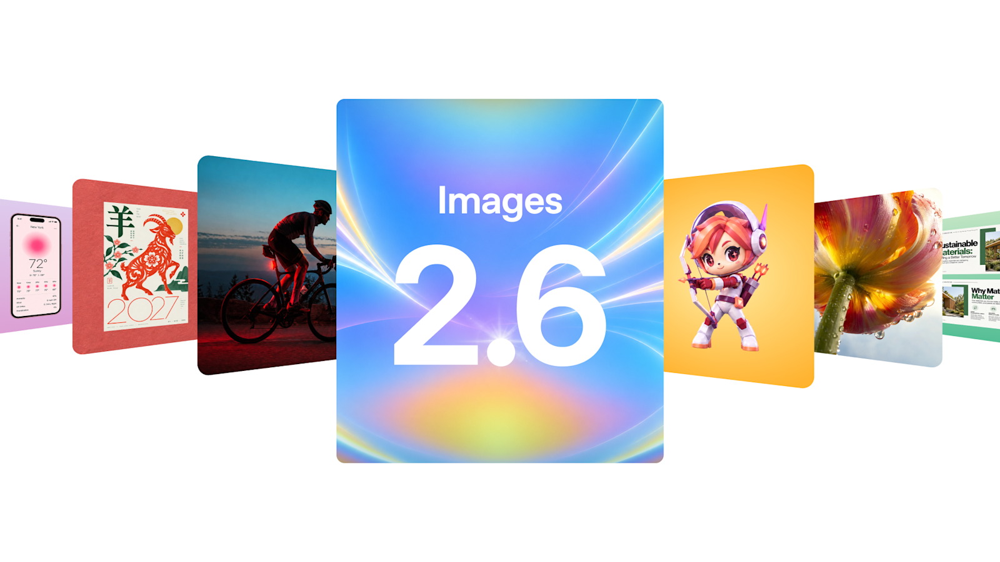
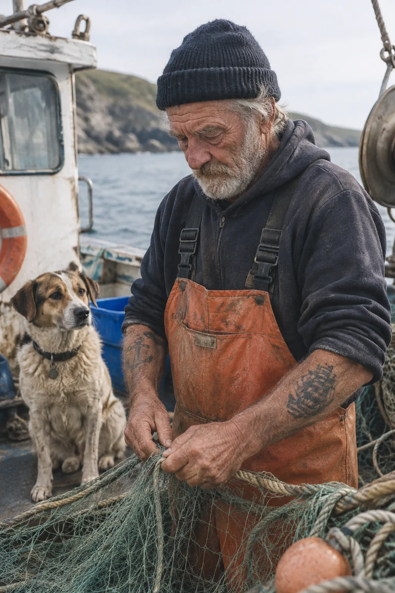
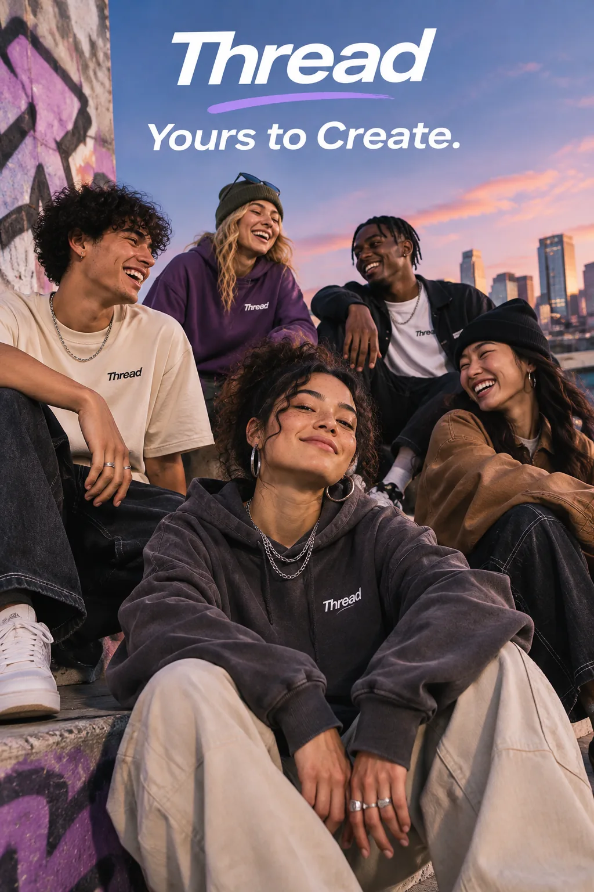
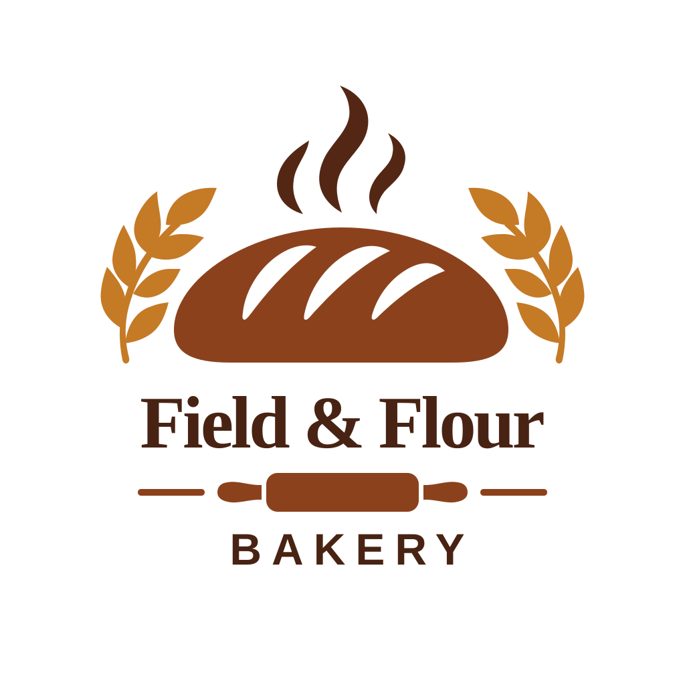
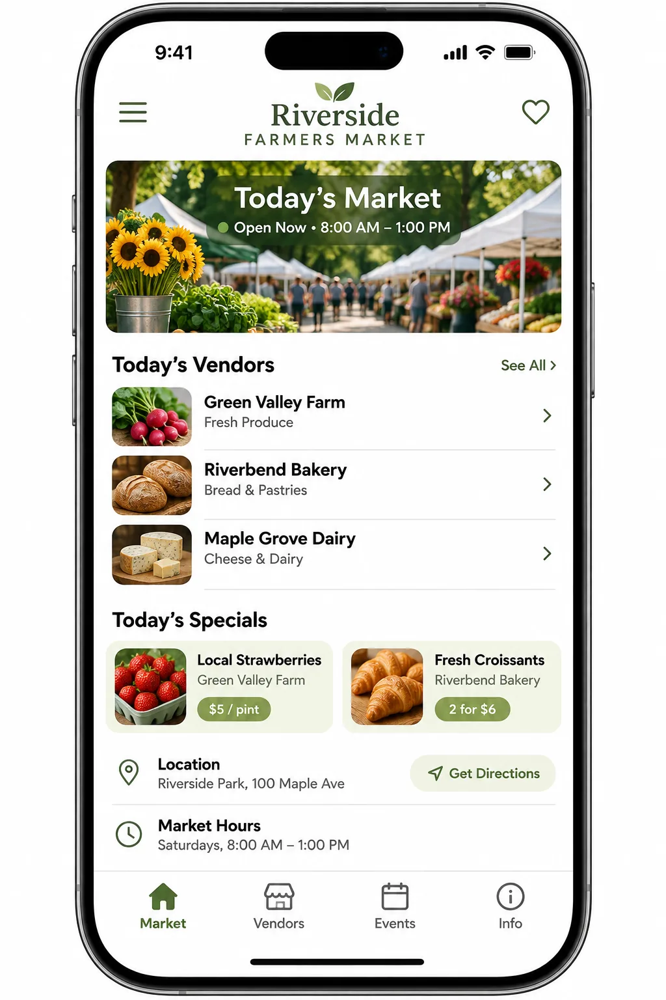
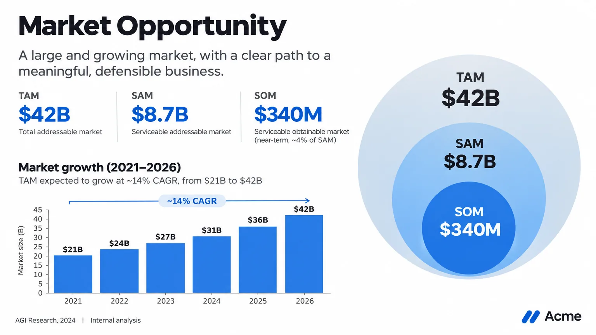
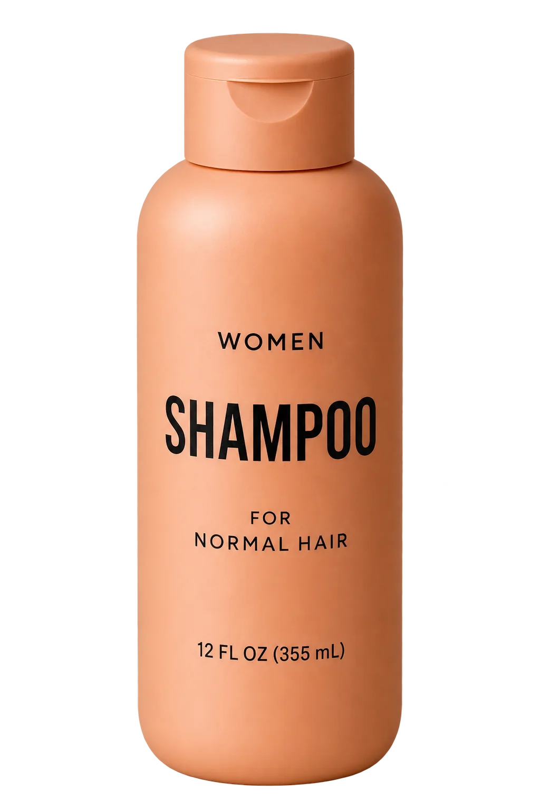

# Awesome GPT Image 2.6（Images 2.6）

> 非官方精选合集：介绍 OpenAI **Images 2.6** / **GPT Image 2.6**（Flare & Sunburst）的模型特性、接入方式与可复现案例画廊。  
> 图例与提示词均整理自 OpenAI 官方公告与开发者文档；仓库内图片为文档示例的镜像缓存，版权归原作者/OpenAI 所有，仅作学习索引。



| 项目 | 内容 |
|------|------|
| 产品名（ChatGPT / Codex） | **Images 2.6** |
| API 型号 | `gpt-image-2.6-flare`、`gpt-image-2.6-sunburst` |
| 厂商 | OpenAI |
| 公开发布 | **2026-11-04**（UTC 口径的官方发布日） |
| 可用入口 | ChatGPT、Codex、Images API（`/v1/images/generations`、`/v1/images/edits`） |

本页 GitHub Pages：<https://xianyu110.github.io/awesome-gpt-images-2.6/>

---

## 简介

OpenAI 于 2026 年 11 月 4 日推出 **Images 2.6**。官方称相对上一代，图像生成速度约 **提升 50%**；在 ChatGPT / Codex 全订阅档位可用，API 侧提供两档模型：

- **GPT Image 2.6 Flare**（`gpt-image-2.6-flare`）：偏重**快速迭代**。`quality=low` 时官方称最快约 **6 秒**；海报、产品图等版式质量有改善。
- **GPT Image 2.6 Sunburst**（`gpt-image-2.6-sunburst`）：偏重**细节与编辑一致性**；`quality` 为 medium/high 时更适合精细构图与多轮精修。

两款模型均支持文生图与图生图/编辑，官方强调角色、产品与品牌细节在编辑轮次中更易保持一致，并新增 **原生 GIF 动画**、**SVG 导出**、API 侧 **markup（标注）引导编辑**，以及独立的 **`complexity`（规划复杂度）** 参数。

> 命名说明：对外产品页多用 **Images 2.6**；API 文档与模型卡使用 **GPT Image 2.6 Flare / Sunburst**。社区口语中的「GPT Images 2.6」一般即指上述产品线。

主要来源：[Introducing Images 2.6](https://openai.com/index/introducing-images-2-6/) · [Image generation](https://developers.openai.com/api/docs/guides/image-generation) · [Image prompting](https://developers.openai.com/api/docs/guides/image-prompting)

---

## 模型特性

### 能力边界（据官方文档）

| 能力 | 说明 |
|------|------|
| 生成 | `POST /v1/images/generations`，文本提示 → 图像 |
| 编辑 | `POST /v1/images/edits`，参考图 / mask / markup + 提示 → 图像 |
| 输入模态 | 文本、图像 |
| 输出格式 | `png` / `jpeg` / `webp`；**生成**另支持 `svg`、`gif`（编辑端不支持 GIF/SVG 输出） |
| 透明背景 | `background=transparent`，配合 PNG/WebP/SVG |
| GIF | `frame_count`（约 2–64，以当前文档为准）、`frame_duration_ms`（约 20–2000，10ms 对齐） |
| SVG | 静态矢量路径；不可流式、不可 partial；`n=1` |
| Markup 编辑 | 与首张输入图同尺寸的透明 PNG 标注层，圈出要改区域 |
| 流式 | 支持 partial images（GIF/SVG 除外） |

### 关键参数（GPT Image 2.6）

| 参数 | 取值 | 作用 |
|------|------|------|
| `model` | `gpt-image-2.6-flare` / `gpt-image-2.6-sunburst` | 选型 |
| `quality` | `auto` / `low` / `medium` / `high` / `xhigh` / `max` | 渲染细节与保真度 |
| `complexity` | `low` / `medium` / `high`（省略时默认 `high`） | 生成前规划程度；与 quality 独立，无单独计费项 |
| `size` | `auto` 或如 `1024x1024`、`1536x1024`、`1024x1536`；自定义宽高需为 16 倍数，纵横比约 1:3–3:1 | 输出尺寸 |
| `background` | `auto` / `opaque` / `transparent` | 背景 |
| `output_format` | `png` / `jpeg` / `webp` / `svg` / `gif` | 输出格式 |
| `markup` | 透明 PNG 叠加层（仅 edits） | 局部编辑定位 |

### 与上一代的差异（官方表述摘要）

- 速度：Images 2.6 宣称较之前约快 **50%**；Flare 在 low quality 可达约 6 秒。
- 新增：原生 **GIF**、**SVG**、API **markup**、独立 **`complexity`**。
- 定位延续 2.5 的 Flare（快）/ Sunburst（精）双轨；官方建议从对应的 2.5 工作流迁移到 2.6 同名档位，再对比延迟与质量。
- 编辑侧：官方称角色/产品/品牌一致性更好；2.6 **不支持** `input_fidelity`、`reasoning.summary`（文档明确）。

### 定价快照（模型卡，可能变动）

Flare 与 Sunburst 公开模型卡上的 token 价目一致（以官网为准）：

| 类型 | 价格 |
|------|------|
| 文本输入 | $5 / 1M tokens（缓存输入 $1.25） |
| 图像输入 | $8 / 1M tokens（缓存输入 $2） |
| 图像输出 | $30 / 1M tokens |

详见：[Flare 模型卡](https://developers.openai.com/api/docs/models/gpt-image-2.6-flare) · [Sunburst 模型卡](https://developers.openai.com/api/docs/models/gpt-image-2.6-sunburst) · [Pricing](https://openai.com/api/pricing/)

### 已知限制（官方）

- 复杂提示可能延迟较长（文档提到可达约 2 分钟量级）。
- 文字渲染已改善，但精确排版仍可能出错。
- 跨多次生成的角色/品牌一致性仍可能漂移，需复述约束或固定参考图。
- 结构化构图的精确定位仍有挑战。
- 内容审核：`moderation=auto|low`；违规返回 `moderation_blocked` 等。

---

## 快速开始 / 接入

### 官方（推荐）

1. 在 [OpenAI Platform](https://platform.openai.com/) 创建项目并完成组织验证（部分图像能力需要）。
2. 设置环境变量 `OPENAI_API_KEY`。
3. 调用 Images API，例如：

```bash
curl -X POST "https://api.openai.com/v1/images/generations" \
  -H "Authorization: Bearer $OPENAI_API_KEY" \
  -H "Content-Type: application/json" \
  -d '{
    "model": "gpt-image-2.6-sunburst",
    "prompt": "A minimalist product poster of a ceramic mug on limestone, soft window light, no text",
    "quality": "medium",
    "complexity": "low",
    "size": "1024x1024",
    "output_format": "png"
  }'
```

Python 示例（摘自官方引导的模型 ID 习惯）：

```python
from openai import OpenAI
import base64

client = OpenAI()
result = client.images.generate(
    model="gpt-image-2.6-flare",
    prompt="A children's book drawing of a veterinarian listening to a baby otter with a stethoscope.",
    quality="medium",
    size="1024x1024",
)
Path = __import__("pathlib").Path
Path("otter.png").write_bytes(base64.b64decode(result.data[0].b64_json))
```

更多： [Image generation guide](https://developers.openai.com/api/docs/guides/image-generation) · [Image prompting guide](https://developers.openai.com/api/docs/guides/image-prompting)

ChatGPT 用户可直接在对话中使用 Images 2.6（含 GIF）；无需写代码。

### 兼容网关（可选、轻量提及）

若团队已使用 OpenAI 兼容中转，可将 `base_url` 指向兼容端点，模型名仍用 `gpt-image-2.6-flare` / `gpt-image-2.6-sunburst`（以网关实际挂载为准）。合规与计费以各服务商条款为准；**优先官方**。  
（本仓库不对第三方网关可用性做保证。若使用 tryallapi 一类兼容入口，可自行附加 `aff=5A6A` 参数，非必需。）

相关工具/店铺（可选）：[https://wzyp.cn/shop/maynorai](https://wzyp.cn/shop/maynorai)

---

## 案例画廊

下列案例提示词与示意输出均整理自 OpenAI 官方文档/公告。图片保存在本仓库 `images/`，便于离线浏览与 Pages 展示。**提示词原文收录并注明来源**；未公开提示词的示例会标明「提示词未公开」。

### 1. Complexity 对比：纸雕足球夺冠（Sunburst）

**场景**：同一提示、同一 `quality=medium`，对比 `complexity=low|medium|high` 对构图与「CHAMPIONS」位置的影响。

**提示词**：

```text
A premium handcrafted layered paper-cut illustration of a football team celebrating a championship victory inside a packed stadium.
```

**参数提示**：`model=gpt-image-2.6-sunburst`，`size=1024x1536`，`quality=medium`

| Low | Medium | High |
|-----|--------|------|
|  |  |  |

来源：[Image prompting · Compare complexity](https://developers.openai.com/api/docs/guides/image-prompting)

---

### 2. 原生循环 GIF：提灯小猴（Sunburst）

**提示词**：

```text
A little monkey in an olive-green hooded coat stands in a snowy pine forest at dusk. A wooden cabin glows in the background. The monkey holds a glowing amber paper lantern at chest height, slowly lifts it, looks up and blinks, then lowers it back to its starting pose. Keep the lantern in its hands and the camera still. Make the motion loop smoothly.
```

**参数提示**：`output_format=gif`，`size=512x512`，`quality=high`，`frame_count=9`，`frame_duration_ms=200`（约 1.8s 循环）


来源：[Image prompting · Generate a looping GIF](https://developers.openai.com/api/docs/guides/image-prompting)

---

### 3. 纪实摄影风：渔民与狗（Flare vs Sunburst）

**提示词**：

```text
Create a photorealistic candid photograph of an elderly sailor standing on a small fishing boat.
He has weathered skin with visible wrinkles, pores, and sun texture, and a few faded traditional sailor tattoos on his arms.
He is calmly adjusting a net while his dog sits nearby on the deck. Shot like a 35mm film photograph, medium close-up at eye level, using a 50mm lens.
Soft coastal daylight, shallow depth of field, subtle film grain, natural color balance.
The image should feel honest and unposed, with real skin texture, worn materials, and everyday detail. No glamorization, no heavy retouching.
```

| Flare | Sunburst |
|-------|----------|
|  |  |

来源：[Image prompting · Control style and lighting](https://developers.openai.com/api/docs/guides/image-prompting)

---

### 4. 信息图：全自动咖啡机流程（Sunburst）

**提示词**：

```text
Create a detailed Infographic of the functioning and flow of an automatic coffee machine like a Jura.
From bean basket, to grinding, to scale, water tank, boiler, etc.
I'd like to understand technically and visually the flow.
```


来源：[Image prompting · Explain a process visually](https://developers.openai.com/api/docs/guides/image-prompting)

---

### 5. 精确文案广告：Thread「Yours to Create.」（Sunburst）

**提示词**：

```text
Give me a cool in culture ad / fashion shot for a brand called Thread.
It's a hip young street brand. The ad shows a group of friends hanging out together with the tagline "Yours to Create."
Make it feel like a polished campaign image for a youth streetwear audience: stylish, contemporary, energetic, and tasteful.
Use clean composition, strong color direction, natural poses, and premium fashion photography cues.
Render the tagline exactly once, clearly and legibly, integrated into the ad layout.
No extra text, no watermarks, no unrelated logos.
```



来源：[Image prompting · Render exact text](https://developers.openai.com/api/docs/guides/image-prompting)

---

### 6. SVG Logo：Field & Flour 面包店

**提示词**：

```text
Create an original, non-infringing logo for a company called Field & Flour, a local bakery.
The logo should feel warm, simple, and timeless. Use clean, vector-like shapes, a strong silhouette, and balanced negative space.
Favor simplicity over detail so it reads clearly at small and large sizes. Flat design, minimal strokes, no gradients unless essential.
Fully transparent background. Deliver a single centered logo with generous padding, clean alpha edges, and no solid backdrop, scenery, checkerboard, or watermark.
```

**参数提示**：`output_format=svg`，`n=1`

| Flare SVG | Sunburst SVG | Sunburst 栅格示例 |
|-----------|--------------|-------------------|
|  |  |  |

来源：[Image prompting · Generate SVG / Design a reusable logo](https://developers.openai.com/api/docs/guides/image-prompting)

---

### 7. 四格漫画：宠物在家狂欢（Sunburst）

**提示词**：

```text
Create a short vertical comic-style reel with 4 panels.
Panel 1: The owner leaves through the front door. The pet is framed in the window behind them, small against the glass, eyes wide, paws pressed high, the house suddenly quiet.
Panel 2: The door clicks shut. Silence breaks. The pet slowly turns toward the empty house, posture shifting, eyes sharp with possibility.
Panel 3: The house transformed. The pet sprawls across the couch like it owns the place, crumbs nearby, sunlight cutting across the room like a spotlight.
Panel 4: The door opens. The pet is seated perfectly by the entrance, alert and composed, as if nothing happened.
```


来源：[Image prompting · Turn a story into a comic strip](https://developers.openai.com/api/docs/guides/image-prompting)

---

### 8. UI 预览：农贸市场 App（Sunburst）

**提示词**：

```text
Create a realistic mobile app UI mockup for a local farmers market.
Show today's market with a simple header, a short list of vendors with small photos and categories, a small "Today's specials" section, and basic information for location and hours.
Design it to be practical, and easy to use. White background, subtle natural accent colors, clear typography, and minimal decoration.
It should look like a real, well-designed, beautiful app for a small local market.
Place the UI mockup in an iPhone frame.
```



来源：[Image prompting · Create an interface preview](https://developers.openai.com/api/docs/guides/image-prompting)

---

### 9. 科学教育图：细胞呼吸一览（Sunburst）

**提示词**：

```text
Create a simple biology diagram titled "Cellular Respiration at a Glance" for high school students.

Show how glucose turns into energy inside a cell. Include glycolysis, the Krebs cycle, and the electron transport chain.
Use arrows to connect the steps, and label the main molecules: glucose, pyruvate, ATP, NADH, FADH2, CO2, O2, and H2O.
Make it look like a clean classroom handout or slide, with a white background, simple icons, clear labels, and easy-to-read text.

Avoid tiny text, extra decoration, or anything that makes the diagram hard to understand.
```


来源：[Image prompting · Create scientific and educational visuals](https://developers.openai.com/api/docs/guides/image-prompting)

---

### 10. 路演幻灯片：Market Opportunity（Sunburst）

**提示词**（文中 TAM/SAM/SOM 等数字为官方示例中的**虚构**数据，使用前请替换为真实数据）：

```text
Create one pitch-deck slide titled **"Market Opportunity"** that feels like a real Series A fundraising slide from a YC-backed startup.

Use a clean white background, modern sans-serif typography like Inter, and a crisp, minimal layout. The slide should include:

* A TAM/SAM/SOM concentric-circle diagram in muted blues and grays
* Specific, believable market sizing numbers:

  * **TAM:** $42B
  * **SAM:** $8.7B
  * **SOM:** $340M
* A clean bar chart below showing market growth from **2021 to 2026**, with a subtle upward trend
* Small footnotes: **"AGI Research, 2024"** and **"Internal analysis"**
* A company logo placeholder in the bottom-right corner

The design should look like it belongs in a deck that actually raised money: highly readable text, clear data hierarchy, polished spacing, and professional startup-style visual language.

Avoid clip art, stock photography, gradients, shadows, decorative elements, or anything that feels generic or overdesigned.
```



来源：[Image prompting · Build slides, diagrams, and charts](https://developers.openai.com/api/docs/guides/image-prompting)

---

### 11. Markup 局部编辑：厨房花瓶改色（Flare）

左：标注预览输入；右：Flare 编辑结果。

**提示词**：

```text
Recolor the striped vase inside the red circle to solid cobalt blue ceramic. Keep its shape, the dried stems, and the rest of the kitchen unchanged. Remove the red circle from the finished photo.
```

| 输入（含标注） | Flare 输出 |
|----------------|------------|
|  |  |

来源：[Image prompting · Guide an edit with markup](https://developers.openai.com/api/docs/guides/image-prompting) · [Image generation · markup](https://developers.openai.com/api/docs/guides/image-generation)

---

### 12. 透明抠图产品（Sunburst）

**提示词**：

```text
Extract the product from the input image and isolate it on a fully transparent background.
Output: centered product, crisp silhouette, no halos/fringing.
Preserve product geometry and label legibility exactly.
Add only light polishing. Do not add a solid backdrop, checkerboard, scenery, or shadow.
Do not restyle the product; remove the background and preserve clean alpha transparency.
```



来源：[Image prompting · Create a transparent product cutout](https://developers.openai.com/api/docs/guides/image-prompting)

---

### 13. 节日贺卡：旧泰迪熊（Sunburst）

**提示词**：

```text
Create a Christmas holiday card illustration.

Scene:
a cozy Christmas scene with an old teddy bear sitting inside a keepsake box, slightly worn fur, soft stitching repairs, placed near a window with falling snow outside. The scene suggests the child has grown up, but the memories remain.

Mood:
Warm, nostalgic, gentle, emotional.

Style:
Premium holiday card photography, soft cinematic lighting,
realistic textures, shallow depth of field,
tasteful bokeh lights, high print-quality composition.

Constraints:
- Original artwork only
- No trademarks
- No watermarks
- No logos

Include ONLY this card text (verbatim):
"Merry Christmas — some memories never fade."
```


来源：[Image prompting · Design a holiday card](https://developers.openai.com/api/docs/guides/image-prompting)

---

### 14. 收藏玩具包装：复古螺旋桨飞机（Sunburst）

**提示词**：

```text
Create a collectible action figure of a vintage-style toy propeller airplane with rounded wings, a front-mounted spinning propeller, slightly worn paint edges, classic childhood proportions, designed as a nostalgic holiday collectible, in blister packaging.

Concept:
A nostalgic holiday collectible inspired by the simple toy airplanes
children used to play with during winter holidays.
Evokes warmth, imagination, and childhood wonder.

Style:
Premium toy photography, realistic plastic and painted metal textures,
studio lighting, shallow depth of field,
sharp label printing, high-end retail presentation.

Constraints:
- Original design only
- No trademarks
- No watermarks
- No logos

Include ONLY this packaging text (verbatim):
"Christmas Memories Edition"
```


来源：[Image prompting · Design collectible merchandise](https://developers.openai.com/api/docs/guides/image-prompting)

---

### 15. 公告案例：OpenArt 股价表情 GIF 精灵表

OpenAI 发布页展示了由 OpenArt 制作的 chibi 办公室职员动画精灵表示例（两套：下跌流泪 / 上涨撒钱）。完整英文提示词见公告原文（篇幅较长，此处不重复粘贴全文，请点来源）。

**提示词**：已在官方公告公开（Prompt 1 / Prompt 2）。  
**本仓库图片**：公告社交头图缓存见 `images/images-2-6-social.png`；精灵表逐帧大图请直接查看公告页（避免二次转存动态资源失效）。

来源：[Introducing Images 2.6 · Animate your ideas with GIFs](https://openai.com/index/introducing-images-2-6/)

---

## 选型建议（官方引导摘要）

| 你的现状 | 建议先测 |
|----------|----------|
| 现有 GPT Image 2 / 2.5 Flare 已够用，更在意速度 | `gpt-image-2.6-flare` |
| 复杂任务、细节或编辑精度不足，或在用 2.5 Sunburst | `gpt-image-2.6-sunburst` |

同一提示、参考图、尺寸与 `quality` 下对比两档；编辑任务可从 `complexity=low` 起步，版式/多元素场景再升 medium/high。

---

## 参考资料

1. [Introducing Images 2.6 \| OpenAI](https://openai.com/index/introducing-images-2-6/)（2026-11-04）
2. [Image generation \| OpenAI API](https://developers.openai.com/api/docs/guides/image-generation)
3. [Image prompting \| OpenAI API](https://developers.openai.com/api/docs/guides/image-prompting)
4. [GPT-Image-2.6 Flare 模型卡](https://developers.openai.com/api/docs/models/gpt-image-2.6-flare)
5. [GPT-Image-2.6 Sunburst 模型卡](https://developers.openai.com/api/docs/models/gpt-image-2.6-sunburst)
6. [OpenAI API Pricing](https://openai.com/api/pricing/)
7. [界面新闻快讯摘要](https://www.jiemian.com/article/15295411.html)（中文报道，非官方）

---

## 免责声明

- 本仓库为**非官方**学习索引，与 OpenAI 无隶属关系。
- 示例图与提示词版权归 OpenAI / 原作者；镜像仅供教育索引，请勿商用盗用。
- 模型能力、价格、限额以官方最新文档为准，本 README 可能滞后。
- 生成内容须遵守 OpenAI 使用政策与当地法律。

## License

教程与仓库编排代码采用 [MIT](LICENSE)。第三方图片与提示词保留原权利。
